<div align="center">

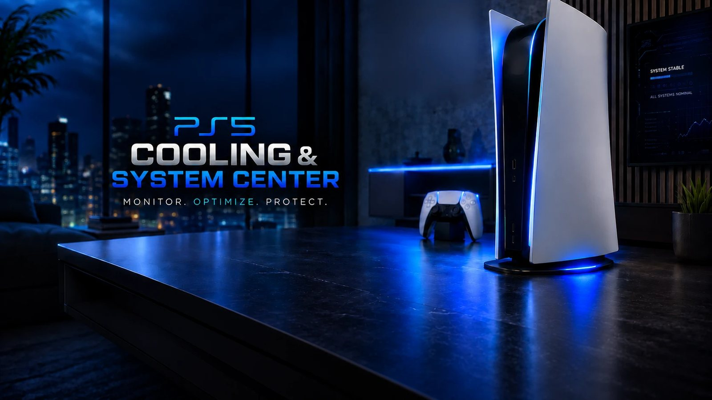

# PS5 Cooling & System Center - Pro

**Contrôle du ventilateur, surveillance de la température et centre système pour la PlayStation 5 jailbreakée,<br>utilisable dans le navigateur de la console ou depuis tout appareil du réseau domestique, en six langues.**


[Fonctions](#fonctions) · [Démarrage rapide](#démarrage-rapide) · [Prérequis](#prérequis) · [Utilisation](#utilisation) · [Documentation](#documentation) · [Mentions légales](#mentions-légales-et-clause-de-non-responsabilité) · [Crédits](#crédits-et-remerciements)

[Deutsch](README.md) · [English](README.en.md) · [Italiano](README.it.md) · [Español](README.es.md) · **Français** · [Русский](README.ru.md)

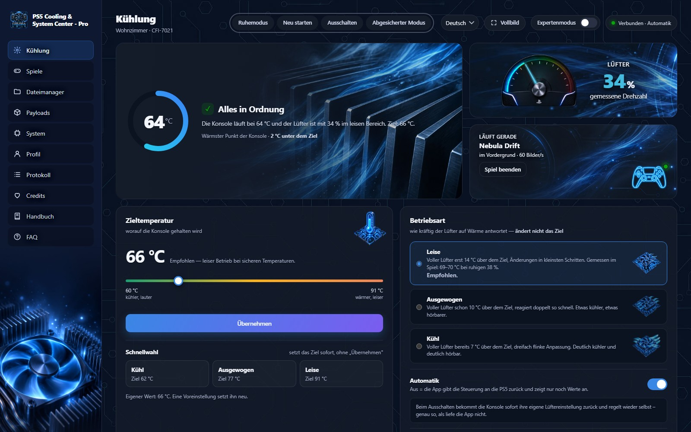

</div>

Un payload homebrew (ELF) qui lit les capteurs de température de la PS5, pilote le ventilateur selon une courbe de confort silencieuse et réglable et fournit une interface web. En plus : gestion des jeux, des fichiers, des payloads et du profil. Tout tourne sur la console elle-même, sans PC et sans Internet.

## Fonctions

<table>
  <tr>
    <td width="33%" valign="top">
      <h3>🌡️ Refroidissement</h3>
      Régulation silencieuse vers une température cible (60–91 °C), modes, profils par jeu, mode nuit avec une cible plus silencieuse, auto-test du ventilateur, limite de sécurité laissée au matériel.
    </td>
    <td width="33%" valign="top">
      <h3>📊 Mesures</h3>
      Processeur, puce principale, GPU (Pro), ventilateur, charge des cœurs, fréquences, rails d'alimentation, images/s et batterie de la manette, avec historique.
    </td>
    <td width="33%" valign="top">
      <h3>🎮 Jeux</h3>
      Lancer, fermer, copier, déplacer, convertir en exFAT/ffpkg/ffpfsc, asset packs LZ4, APR-EMU, PlayGo.
    </td>
  </tr>
  <tr>
    <td valign="top">
      <h3>💾 PS4 depuis USB</h3>
      Jouer aux faux PKG PS4 directement depuis un disque USB sans les installer (PS4Mount intégré), avec mises à jour et DLC.
    </td>
    <td valign="top">
      <h3>📦 Paquets et sauvegardes</h3>
      Trouver, découper et installer des PKG ; sauvegarder et restaurer les données de jeu ; temps de jeu avec températures.
    </td>
    <td valign="top">
      <h3>📁 Fichiers et payloads</h3>
      Gestionnaire de fichiers pour la console et les disques ; télécharger des payloads (la liste du Payload Manager), les lancer et les arrêter, les charger à la suite comme profils.
    </td>
  </tr>
  <tr>
    <td valign="top">
      <h3>🖥️ Système et journal</h3>
      Modèle, firmware, réseau, écran ; journal des événements et journal du noyau en direct avec enregistrement.
    </td>
    <td valign="top">
      <h3>🕹️ Raccourcis manette</h3>
      L1/R1 changent de page, L2/R2 font défiler ; deux appuis sur Muet affichent température et ventilateur sur la TV.
    </td>
    <td valign="top">
      <h3>🚀 Vignette de lancement</h3>
      Un dossier pour <code>/data/homebrew</code> : un appui sur sa vignette lance l'appli et ouvre l'interface.
    </td>
  </tr>
</table>

### Écrans

<table>
  <tr>
    <td width="50%">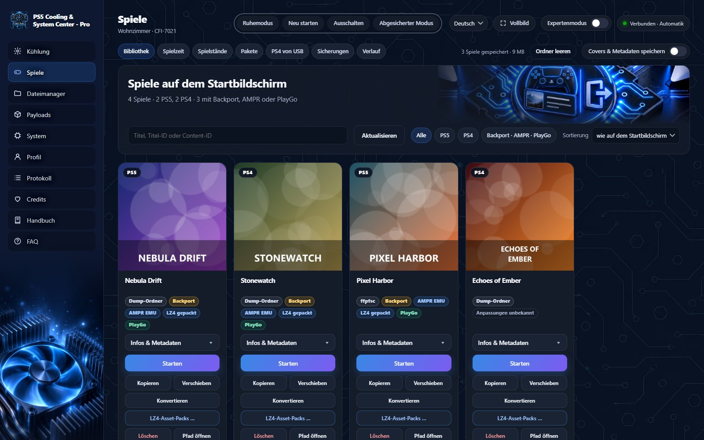</td>
    <td width="50%">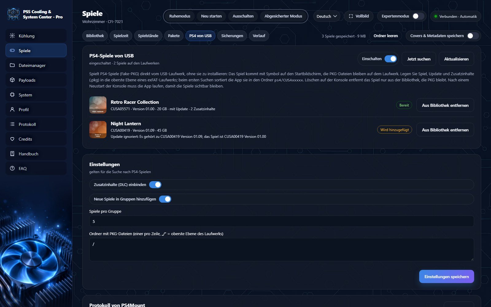</td>
  </tr>
  <tr>
    <td align="center"><sub>Jeux : bibliothèque avec lancer, copier, convertir</sub></td>
    <td align="center"><sub>PS4 depuis USB : faux PKG sans installation</sub></td>
  </tr>
  <tr>
    <td>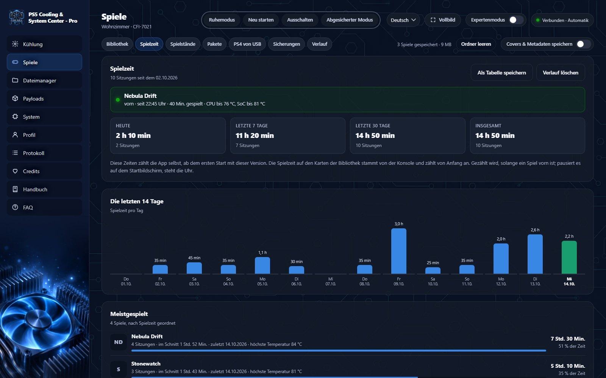</td>
    <td>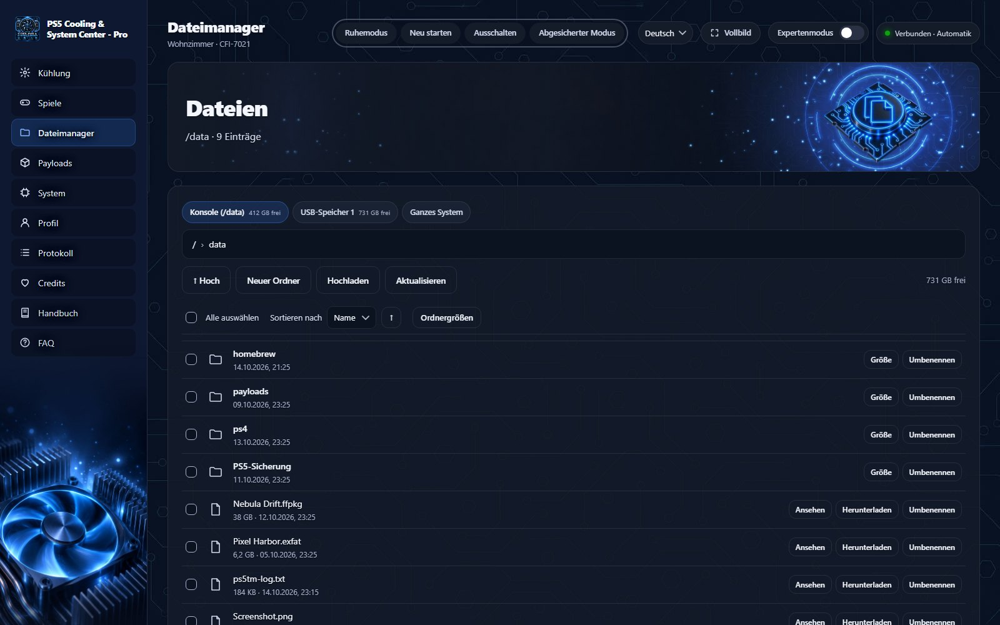</td>
  </tr>
  <tr>
    <td align="center"><sub>Temps de jeu avec graphique journalier et températures</sub></td>
    <td align="center"><sub>Gestionnaire de fichiers pour la console et les disques USB</sub></td>
  </tr>
  <tr>
    <td>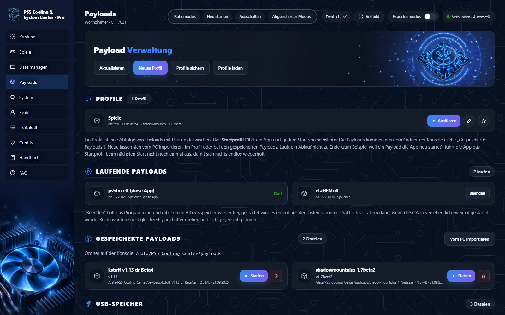</td>
    <td>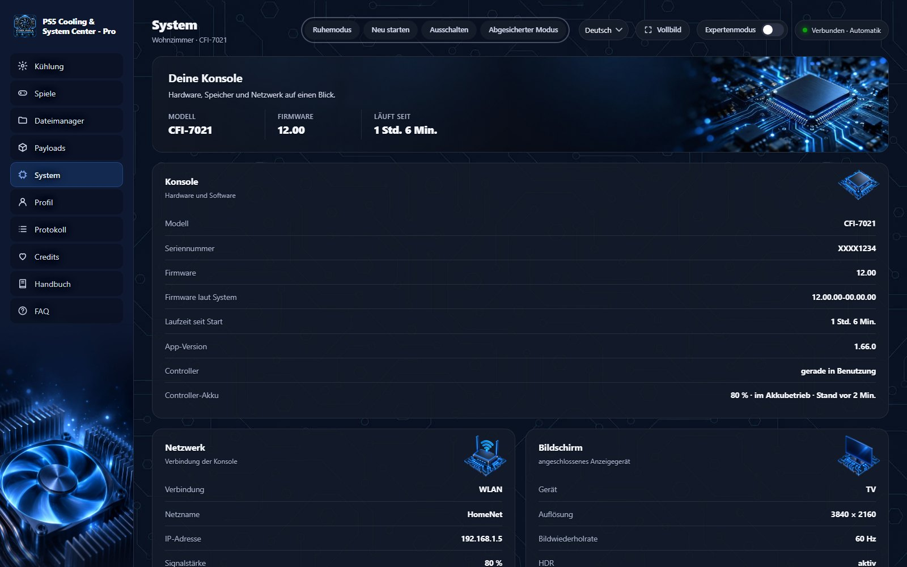</td>
  </tr>
  <tr>
    <td align="center"><sub>Payloads : profils, en cours et enregistrés</sub></td>
    <td align="center"><sub>Système : console, réseau, écran</sub></td>
  </tr>
</table>

<details>
<summary><b>Autres écrans</b> (refroidissement en détail, sauvegardes, paquets, profil, journal, téléphone)</summary>
<br>
<table>
  <tr>
    <td width="50%">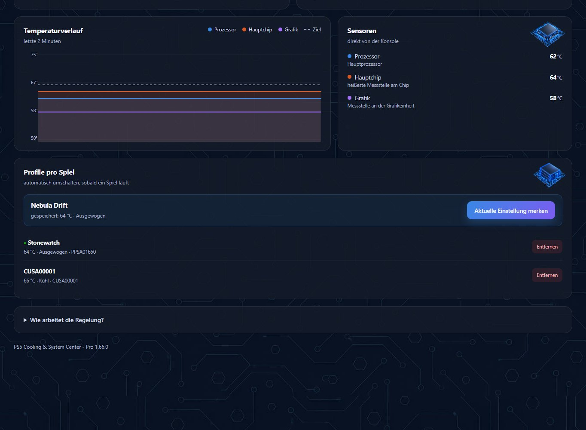</td>
    <td width="50%">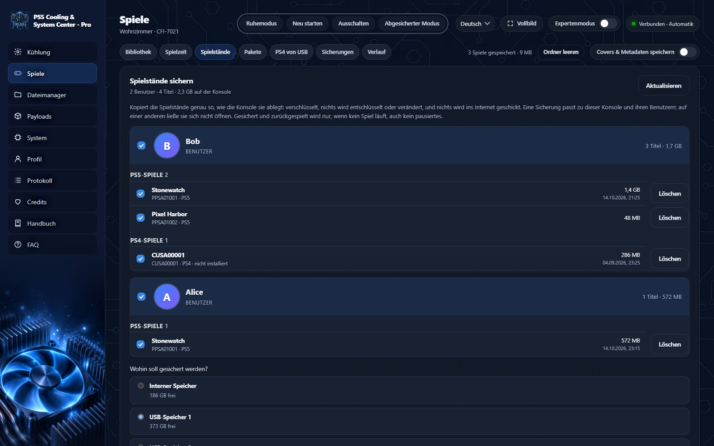</td>
  </tr>
  <tr>
    <td>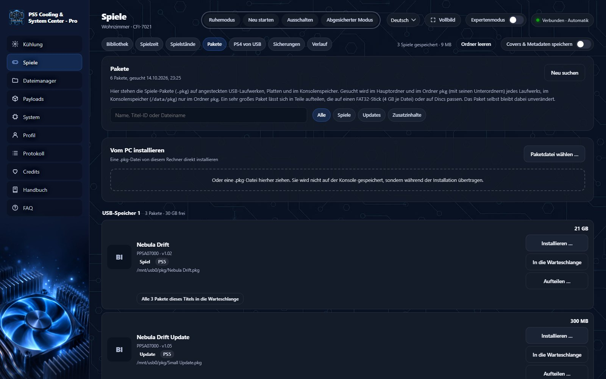</td>
    <td>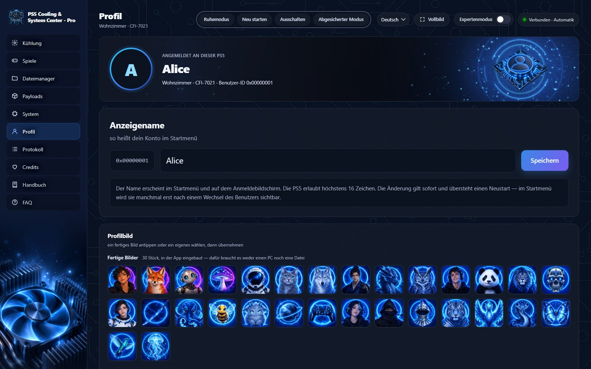</td>
  </tr>
  <tr>
    <td>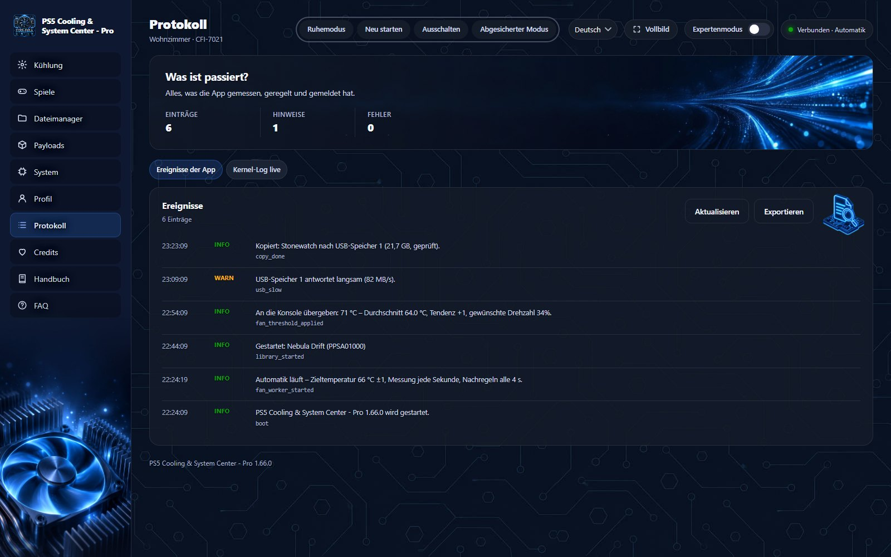</td>
    <td align="center">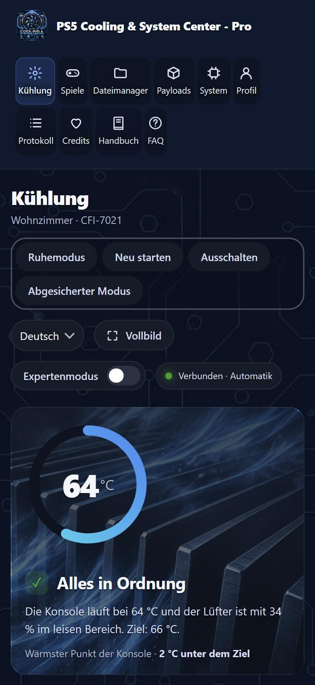</td>
  </tr>
</table>
<sub>Toutes les images avec des données d'exemple et des jeux inventés ; l'interface est montrée en allemand.</sub>
</details>

<details>
<summary><b>Toutes les fonctions en détail</b></summary>

**Refroidissement**
- Maintient une température cible (66 °C par défaut, réglable de 60 à 91 °C) avec moyenne glissante, zone morte et tendance, et ne change la vitesse que par petits pas.
- Modes silencieux, équilibré et frais, choix rapides et règles par jeu.
- Au-delà de la température de sécurité (78 °C par défaut) seul le matériel décide ; quand l'appli ne tourne pas, la console régule seule.
- Mode nuit : entre deux heures, une cible plus silencieuse s'applique ; l'heure est celle de l'appareil sur lequel la page est ouverte.
- Auto-test du ventilateur d'un bouton (le ventilateur répond-il au seuil ?) et vitesse minimale apprise de la console (20 % au repos, 34 % en jeu), affichée dans le diagnostic.

**Jeux**
- Lancer (depuis le navigateur de la console la page se ferme aussitôt), fermer, copier vers d'autres disques, déplacer ou décompresser avec ShadowMountPlus.
- Convertir en images exFAT, ffpkg et ffpfsc sans PC ; tout est relu et vérifié après écriture, avec un fichier `.sha256`.
- Asset packs LZ4, index AMPR, APR-EMU, stub PlayGo et modules DLC par jeu ; vérifier, décompresser et réparer des images.
- PS4 depuis USB : faux PKG PS4 d'un disque USB dans la bibliothèque sans installation (PS4Mount de gasb07).
- Disc : indique quel disque est dans le lecteur (PS2/PS3/PS4/PS5, ID de titre) et crée une image des DVD PS2 et des disques PS3 avec CRC-32, MD5 et SHA-1, vérifiée avec Redump si on le souhaite (d'après ps-disc-detect).
- Temps de jeu avec températures, sauvegarde et restauration des données de jeu, trouver, découper et installer des paquets, historique de toutes les tâches.

**Gestion**
- Gestionnaire de fichiers : afficher, télécharger et envoyer, créer des dossiers, renommer, copier, déplacer, supprimer (modifications seulement sur les disques et dans `/data`).
- Payloads : voir et arrêter ceux en cours, lancer ses propres `.elf` depuis un dossier ou une clé USB, profils comme séquence de démarrage ; télécharger et mettre à jour les payloads de la liste du Payload Manager d'itsPLK (vérification SHA-256).
- Profil : nom affiché et image de profil (30 images intégrées ou un fichier personnel).
- Thème : standard, clair, sombre et optimal (le plus rapide à dessiner, pensé pour le téléviseur) ; chaque appareil retient son choix.
- Système : modèle, firmware, durée de fonctionnement, stockage, réseau ; capteurs bruts et diagnostic en mode expert.
- En-tête sur chaque page : mode repos, redémarrer, éteindre, mode sans échec (deux clics chacun).

**Technique**
- Serveur HTTP maison sans bibliothèque tierce, [interface JSON](docs/API.md) documentée, réglages dans `/data/PS5-Cooling-Center/config.json`.
- Aucun accès à Internet, sauf si vous activez les **mises à jour des jeux** (désactivées par défaut) : l'appli interroge alors les serveurs de téléchargement officiels au sujet des mises à jour de vos propres jeux. De même, « Télécharger des payloads » ne récupère la liste et les fichiers sur GitHub qu'après un clic sur le bouton. Sinon, elle ne parle qu'aux programmes de la console et aux navigateurs du réseau domestique.

</details>

## Démarrage rapide

1. Télécharger `PS5_Cooling_System_Center_v<version>.elf` depuis les [Releases](../../releases).
2. L'envoyer à la console (chargeur ELF, port **9021**), par exemple :
   ```bash
   nc -q0 <IP-PS5> 9021 < PS5_Cooling_System_Center_v1.73.1.elf
   ```
3. Ouvrir **`http://<IP-PS5>:8086`** dans un navigateur (la notification en haut à gauche de la TV affiche aussi l'adresse).

> [!TIP]
> **Démarrer sans envoi :** décompresser `PPSA86921.zip` de la release et copier le dossier dans `/data/homebrew/`. ShadowMountPlus crée une vignette ; un appui lance l'appli et ouvre l'interface.

> [!IMPORTANT]
> Une seule **instance** à la fois, sinon deux programmes se disputent le ventilateur. Une ancienne instance s'arrête sur la page « Payloads ». Plus dans le [LIESMICH](docs/LIESMICH.txt) (en allemand).

## Prérequis

| | |
| --- | --- |
| **Console** | PS5 jailbreakée avec un chargeur ELF sur le port 9021 ([elfldr](https://github.com/ps5-payload-dev/elfldr) ou équivalent) |
| **Testé** | PS5 Pro (CFI-7021), firmware 12.00 ; plusieurs utilisateurs signalent que 13.60 fonctionne aussi |
| **Ventilateur** | [kstuff](https://github.com/EchoStretch/kstuff-lite) (sans lui, capteurs et interface fonctionnent, pas la régulation) |
| **Réseau** | Un navigateur sur le même réseau, ou le navigateur de la console |
| **Optionnel** | [ShadowMountPlus](https://github.com/drakmor/ShadowMountPlus) pour déplacer, décompresser et la vignette de lancement |

<details>
<summary>Firmware et SDK en détail</summary>

L'ELF est compilé avec le PS5 payload SDK **v0.44**, dont le code de démarrage connaît le firmware **jusqu'à 13.60**. Un firmware que le code de démarrage ne connaît pas n'atteint jamais `main()` : le programme ne démarre pas du tout et n'écrit rien dans le journal. Pour 13.00 à 13.40 il n'y a pas encore de retour (le code de démarrage les connaît). La température du GPU n'existe que sur la Pro.
</details>

## Utilisation

| Page | Contenu |
| --- | --- |
| **Refroidissement** | État, historique, capteurs, température cible, mode, profils par jeu |
| **Jeux** | Bibliothèque, temps de jeu, sauvegardes, paquets, PS4 depuis USB, copies, historique |
| **Gestionnaire de fichiers** | Dossiers de la console et des disques |
| **Payloads** | Payloads en cours, enregistrés et sur USB, profils, télécharger des payloads |
| **Système** | Console, stockage, réseau, diagnostic |
| **Profil** | Nom affiché et image de profil |
| **Journal** | Événements de l'appli et journal du noyau en direct |
| **Crédits** | Remerciements ; plus le **manuel** et la **FAQ** en six langues |

**À la manette (navigateur de la console) :** L1 / R1 page précédente / suivante · L2 / R2 défiler vers le haut / bas · Muet deux fois : température et ventilateur sur la TV.

> [!WARNING]
> L'interface **n'a pas de connexion** : tout appareil du réseau domestique peut lire et modifier. Ne configurez pas de redirection du port 8086. Pour n'autoriser que le navigateur de la console, mettez `bind_address` à `127.0.0.1`. Détails dans le [manuel](docs/HANDBUCH.md#zugriff-und-sicherheit-im-heimnetz) et la [politique de sécurité](SECURITY.md).

## Documentation

| Document | Contenu |
| --- | --- |
| [Manuel](docs/HANDBUCH.md) | Utilisation en détail (en allemand ; aussi dans l'appli, en six langues) |
| [API](docs/API.md) | Tous les points d'accès et champs de configuration |
| [Développement](docs/ENTWICKLUNG.md) | Compiler, envoyer, dépanner, structure du code |
| [Modifications](CHANGELOG.md) | Ce qui a changé dans chaque version |
| [Journal des décisions](docs/ERWEITERUNGEN.md) | Pourquoi les choses sont ainsi, ce qui a été mesuré |
| [Composants tiers](THIRD_PARTY_NOTICES.md) | Code repris et ses licences |
| [Contribuer](CONTRIBUTING.md) · [Sécurité](SECURITY.md) | Contributions et signalement de failles |

<details>
<summary><b>Compiler depuis le code source</b></summary>

Il faut le [PS5 payload SDK](https://github.com/ps5-payload-dev/sdk) **v0.42 ou plus récent** (testé avec v0.44) ; la compilation le vérifie et s'arrête avec un SDK plus ancien. Sous Windows, Git Bash avec LLVM 21 suffit :

```bash
tools/build-windows.sh
```

Sous Linux ou WSL :

```bash
export PS5_PAYLOAD_SDK=$HOME/ps5sdk/sdk
make
```

Le résultat est `PS5_Cooling_Center.elf` ; `tools/make_starter.sh` crée la vignette de lancement. Le reste est dans [docs/ENTWICKLUNG.md](docs/ENTWICKLUNG.md).
</details>

## Mentions légales et clause de non-responsabilité

> [!CAUTION]
> **Pas un produit officiel, pas de piratage, aucune responsabilité.** Ce projet n'a aucun lien avec les détenteurs des droits de la console. Il ne contient ni jeux, ni firmware, ni clés de tiers (seulement une clé publiquement connue pour des paquets de test créés soi-même, voir THIRD_PARTY_NOTICES.md), ni code pour contourner une protection contre la copie, et il ne télécharge rien depuis Internet sauf, si vous les activez, les mises à jour officielles de vos propres jeux depuis les serveurs officiels. Modifier une console peut coûter la garantie et le compte ; le risque est pour qui le fait. Le programme est fourni **sans aucune garantie**.

<details>
<summary>Texte complet</summary>

> Cette section est une information générale et non un conseil juridique. Toute personne utilisant le projet est responsable de s'assurer que son usage est autorisé dans son pays et vis-à-vis de ses partenaires contractuels.

- **Pas un produit officiel.** « PlayStation », « PS5 » et les logos associés sont des marques de leurs détenteurs respectifs. Ce projet n'a aucun lien avec eux et n'est ni soutenu ni approuvé par eux. Les autres noms appartiennent à leurs propriétaires respectifs.
- **Ta console, ta responsabilité.** Le programme ne fonctionne que sur une console modifiée par son propriétaire. La modification peut enfreindre les conditions d'utilisation et entraîner la perte de la garantie ou le blocage du compte ou de la console, et dans certains pays des suites juridiques. Le risque est pour qui modifie la console et utilise ce programme.
- **Pas de piratage.** Ce projet n'est **pas** fait pour obtenir, diffuser ou utiliser des copies pirates, et ne le soutient pas. Copier, déplacer et convertir n'agissent que sur des jeux déjà présents sur ta console et servent aux sauvegardes de jeux acquis légalement. Trouver, découper, installer et monter des paquets depuis USB n'agissent que sur des paquets que tu as toi-même mis sur la console ou un disque ; l'appli n'en procure aucun. Diffuser des contenus protégés par le droit d'auteur est une infraction dans la plupart des pays. Aucune aide à ce sujet ici, ni dans les issues.
- **Aucun fichier système de tiers dans le dépôt.** Bibliothèques système, firmware et fichiers propriétaires du SDK ne sont ni fournis ni acceptés (voir [CONTRIBUTING](CONTRIBUTING.md)). Les 30 images de profil ont été créées par l'auteur.
- **Aucune garantie, aucune responsabilité.** Le programme intervient sur le contrôle du ventilateur et sur des fonctions système de la console. Il est fourni tel quel, **sans aucune garantie** (GNU GPL, sections 15 et 16). L'auteur n'est pas responsable des dommages aux consoles, données ou comptes. Une console poussiéreuse refroidit moins bien, quelle que soit la régulation du ventilateur.
- **Confidentialité.** Historique, journal et réglages restent sur la console dans `/data/PS5-Cooling-Center/`. L'appli n'envoie aucune donnée sur Internet ; seulement avec les mises à jour des jeux activées, elle interroge les serveurs de mise à jour officiels et des fournisseurs DNS sur les ID de titre de vos propres jeux. Seule exception dans le navigateur : la page « Crédits » charge une fois la petite icône de github.com pour voir si le navigateur a Internet ; ce n'est qu'alors que les liens sont cliquables.
- **Les projets tiers** sont sous leurs propres licences, voir [THIRD_PARTY_NOTICES.md](THIRD_PARTY_NOTICES.md).
</details>

## Contribuer et signaler des bugs

Bugs et souhaits sont les bienvenus en [issue](../../issues), avec modèle de console, firmware, version et le journal exporté (page « Journal »). Contributions : [CONTRIBUTING.md](CONTRIBUTING.md). Merci de signaler les failles de sécurité comme décrit dans [SECURITY.md](SECURITY.md).

## Crédits et remerciements

Ce projet repose sur les épaules de la communauté homebrew PS5. **Merci !** Un remerciement tout particulier à **[Gezine](https://github.com/Gezine)** : sans le travail de Gezine, aucun homebrew ne tournerait sur beaucoup de consoles, et donc cette appli non plus.

<details>
<summary><b>Plateforme et outils</b></summary>

- **John Törnblom et tous les contributeurs de [ps5-payload-dev](https://github.com/ps5-payload-dev)** : le [PS5 payload SDK](https://github.com/ps5-payload-dev/sdk), le chargeur [elfldr](https://github.com/ps5-payload-dev/elfldr), [klogsrv](https://github.com/ps5-payload-dev/klogsrv), [ftpsrv](https://github.com/ps5-payload-dev/ftpsrv) et [websrv](https://github.com/ps5-payload-dev/websrv).
- **Les développeurs de kstuff** : [sleirsgoevy](https://github.com/sleirsgoevy), [EchoStretch](https://github.com/EchoStretch) et [drakmor](https://github.com/drakmor) ([kstuff-lite](https://github.com/EchoStretch/kstuff-lite)). Sans kstuff, pas d'accès au contrôleur du ventilateur.
</details>

<details>
<summary><b>Code d'autres projets (porté ou intégré)</b></summary>

- **[gasb07](https://github.com/gasb07), [PS4Mount](https://github.com/gasb07/ps4mount)** (GPL-3.0) : faux PKG PS4 depuis USB sans installation ; le code est intégré comme onglet « PS4 depuis USB ».
- **[RenanGBarreto](https://github.com/RenanGBarreto), [rdmrocha](https://github.com/rdmrocha) et les contributeurs de [MkPFS](https://github.com/PSBrew/MkPFS)** ([PSBrew](https://github.com/PSBrew), GPL-3.0) : images exFAT, PFS et PFSC.
- **[SvenGDK](https://github.com/SvenGDK), [UFS2Tool](https://github.com/SvenGDK/UFS2Tool)** (BSD-2-Clause) : modèle de l'écriture UFS2/ffpkg.
- **[drakmor](https://github.com/drakmor)** : [ampr_emu](https://github.com/drakmor/ampr_emu) (asset packs LZ4, APR-EMU), [pgo_stub](https://github.com/drakmor/pgo_stub) et [dlc_emu](https://github.com/drakmor/dlc_emu) (versions intégrées, GPL-3.0).
- **[BlackBearReloaded](https://github.com/BlackBearReloaded), ps5-native-app-boilerplate** (GPL-3.0) : la construction de la vignette de lancement comme titre natif.
- **[itsPLK](https://github.com/itsPLK), [ps5-pkg-manager](https://github.com/itsPLK/ps5-pkg-manager)** (GPL-3.0) : structure des paquets et déroulement de l'installation (code propre sur ce modèle).
- **[phantomptr](https://github.com/phantomptr), [ps5upload](https://github.com/phantomptr/ps5upload)** (GPL-3.0) : fonction profil et format de l'image de profil.
- **[slopmaster33](https://github.com/slopmaster33), [webhb](https://github.com/slopmaster33/webhb)** (GPL-3.0) : encodeur QR.
- **[danthespal](https://github.com/danthespal), [MkPFS.CSharp](https://github.com/danthespal/MkPFS.CSharp)** (GPL-3.0) : les quatre profils LZ4 testés (ASTRO BOT, EA Sports UFC 6, moteur d'Insomniac, moteur Unity), intégrés sans modification.
- **[Eric Biggers](https://github.com/ebiggers), [libdeflate](https://github.com/ebiggers/libdeflate)** (MIT) · **[Dave Gamble](https://github.com/DaveGamble), [cJSON](https://github.com/DaveGamble/cJSON)** (MIT) · **[LZ4](https://github.com/lz4/lz4)** (BSD-2-Clause).
</details>

<details>
<summary><b>Collaboration, savoir et modèles</b></summary>

- **[drakmor](https://github.com/drakmor)** : [ShadowMountPlus](https://github.com/drakmor/ShadowMountPlus) (monter, déplacer, décompresser des jeux) et [ps5-hwinfo](https://github.com/drakmor/ps5-hwinfo) (rails d'alimentation, fréquences).
- **V-10, [exFAT2AMPR](https://github.com/exFAT2AMPR/exfat2ampr)** : liste pour « Automatique », enregistrement pour créer des profils, entretien des plugins de jeux.
- **theghostonline (Husam Osman), [PS5 LZ4 Compression](https://github.com/theghostonline/PS5-LZ4-Compression)** : fichiers qui doivent rester séparés à l'empaquetage, droits 0777, réparation lors de la vérification des paquets, choix des profils testés.
- **[kerrdec97](https://github.com/kerrdec97), [exFAT Image Builder](https://github.com/kerrdec97/ps5-exfat-builder)** : paramètres des images `.ffpkg`.
- **[itsPLK](https://github.com/itsPLK)** : [ps5-unified-autoloader](https://github.com/itsPLK/ps5-unified-autoloader) et [ps5-payload-manager](https://github.com/itsPLK/ps5-payload-manager).
- **[StonedModder](https://github.com/StonedModder), [ps-game-state-lib](https://github.com/StonedModder/ps-game-state-lib)** (MIT) : détection du jeu en cours.
- **[etaHEN](https://github.com/etaHEN/etaHEN)** et **[onionHEN](https://github.com/aydencharles/onionHEN)** : appels système, mesures, images/s.
- **[Soniciso](https://git.etawen.dev/soniciso), [Elf Arsenal](https://git.etawen.dev/soniciso/elf-arsenal)** : modèle de nombreuses fonctions (code réécrit à chaque fois).
- **BestPig, [BackPork](https://github.com/BestPig/BackPork)** : le principe des bibliothèques de remplacement.
- **Juma Sayeh et Osama Abualia, PS5 Game Compressor** : idées pour vérifier et convertir (tout réécrit ; son code n'a pas de licence).
- **Pilote Linux `hid-playstation`** (batterie de la DualSense) · **Xbox 360 DashLaunch** (l'idée d'une régulation calme).
</details>

<details>
<summary><b>Merci à la communauté</b></summary>

Leur code n'est pas dans cette appli, mais sans leur travail partagé la scène n'existerait pas ainsi : [owendswang](https://github.com/owendswang), [LightningMods](https://github.com/LightningMods), [Andy Nguyen / TheFloW](https://github.com/TheOfficialFloW), [Specter](https://github.com/Cryptogenic), [ChendoChap](https://github.com/ChendoChap), [idlesauce](https://github.com/idlesauce), [flatz](https://github.com/flatz), [Al Azif](https://github.com/Al-Azif), [zecoxao](https://github.com/zecoxao), [ArkSama](https://github.com/ArkSama), [nexgen999](https://github.com/nexgen999), [matem6](https://github.com/matem6), [Phoenixx1202](https://github.com/Phoenixx1202), [SiSTR0](https://github.com/SiSTR0) – et tous les autres qui contribuent par du code, des tests, des guides ou des réponses. Dans l'appli, tous figurent avec une image sur la page « Crédits ».
</details>

Si vous ne vous trouvez pas ici ou êtes mal décrit, signalez-le : la liste sera volontiers complétée.

## Licence

Copyright © 2026 strongt1me · **GNU General Public License v3.0 ou ultérieure**, voir [LICENSE](LICENSE). Jusqu'à 1.45.1 le projet était sous MIT ; depuis 1.46.0 il est sous GPL-3.0-or-later car il reprend des parties de projets GPL (détails dans [THIRD_PARTY_NOTICES.md](THIRD_PARTY_NOTICES.md)).

<sub>Ce README existe aussi en [Deutsch](README.md), [English](README.en.md), [Italiano](README.it.md), [Español](README.es.md) et [Русский](README.ru.md). Le manuel et la FAQ accompagnent chaque release dans les six langues.</sub>
