<div align="center">

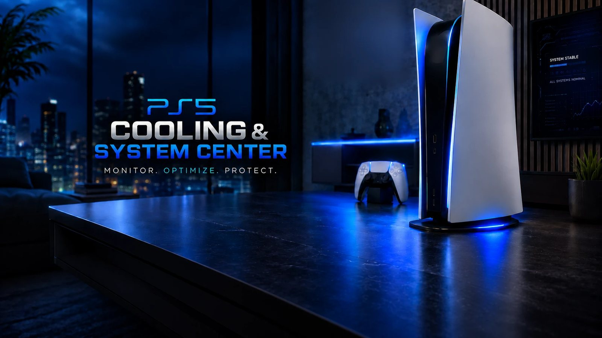

# PS5 Cooling & System Center - Pro

**Contrôle du ventilateur, surveillance de la température et centre système pour la PlayStation 5 jailbreakée,<br>utilisable dans un navigateur (console, téléphone, PC) ou comme application plein écran sur le téléviseur avec la manette, en sept langues.**


[Fonctions](#fonctions) · [Démarrage rapide](#démarrage-rapide) · [Prérequis](#prérequis) · [Utilisation](#utilisation) · [Documentation](#documentation) · [Mentions légales](#mentions-légales-et-clause-de-non-responsabilité) · [Crédits](#crédits-et-remerciements)

[Deutsch](README.de.md) · [English](README.md) · [Italiano](README.it.md) · [Español](README.es.md) · **Français** · [Русский](README.ru.md) · [Svenska](README.sv.md)

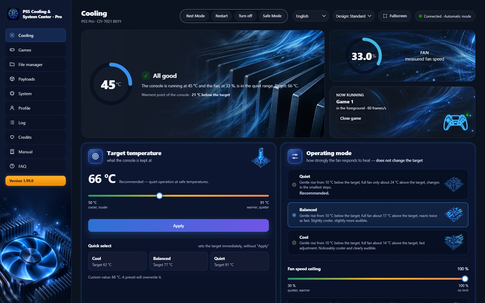

</div>

Un payload homebrew (ELF) qui lit les capteurs de température de la PS5, pilote le ventilateur selon une courbe de confort silencieuse et réglable et fournit une application de navigateur et une application plein écran. En plus : gestion des jeux, des fichiers, des payloads et du profil. Tout tourne sur la console elle-même, sans PC et sans Internet.

## Deux interfaces

Une seule application, deux façons de l'utiliser. L'application plein écran fait presque tout ce que fait l'application de navigateur ; seul l'envoi et le téléchargement de fichiers ne fonctionnent que dans le navigateur.

<table>
  <tr>
    <td width="50%"></td>
    <td width="50%">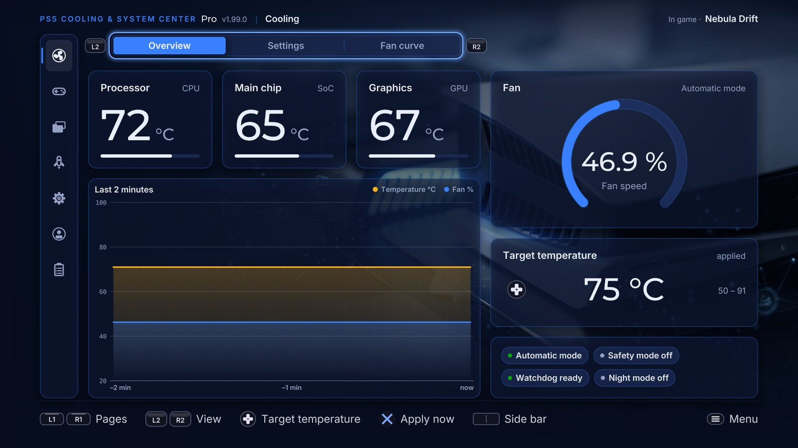</td>
  </tr>
  <tr>
    <td valign="top">
      <h3>🌐 Application de navigateur</h3>
      Dans le navigateur de la console ou depuis un téléphone ou un PC du réseau domestique : <code>http://&lt;PS5-IP&gt;:8086</code>. Avec la vignette <b>FAKE86922</b>, un appui ouvre le navigateur de la console avec l'application. Quatre thèmes, sept langues, manuel et FAQ intégrés.
    </td>
    <td valign="top">
      <h3>📺 Application plein écran</h3>
      La vignette <b>FAKE86921</b> de la zone média de la console remplit le téléviseur et se commande uniquement à la manette, sans navigateur. L1/R1 changent de page, L2/R2 de vue, <b>X</b> ouvre ou lance, <b>Triangle</b> en montre plus, <b>Carré</b> ouvre les actions.
    </td>
  </tr>
</table>

## Fonctions

<table>
  <tr>
    <td width="33%" valign="top">
      <h3>🌡️ Refroidissement</h3>
      Régulation silencieuse vers une température cible (50–91 °C), modes, profils par jeu (avec des suggestions tirées de vos propres sessions et leur effet mesuré), mode nuit avec une cible plus silencieuse, auto-test du ventilateur, rampe de sécurité et gardien du ventilateur.
    </td>
    <td width="33%" valign="top">
      <h3>📊 Mesures</h3>
      Processeur, puce principale, GPU (Pro), ventilateur, charge des cœurs, fréquences, rails d'alimentation, images/s et batterie de la manette, avec historique.
    </td>
    <td width="33%" valign="top">
      <h3>🎮 Jeux</h3>
      Lancer, fermer, copier, déplacer, supprimer, convertir en exFAT/ffpkg/ffpfsc/FPKG, paquets LZ4 et zstd, APR-EMU, PlayGo. Vue compacte (par défaut) ou grande.
    </td>
  </tr>
  <tr>
    <td valign="top">
      <h3>💾 Jouer sans installer</h3>
      Faux PKG PS4 depuis un disque USB avec mises à jour et DLC (PS4Mount), FPKG PS5, dossiers de jeu et images (Kraken Mount) ; les deux intégrés.
    </td>
    <td valign="top">
      <h3>📦 Paquets et sauvegardes</h3>
      Trouver, découper et installer des PKG ; sauvegarder et restaurer les données de jeu et les transférer vers une autre console en ZIP ; temps de jeu avec températures.
    </td>
    <td valign="top">
      <h3>📁 Fichiers et payloads</h3>
      Gestionnaire de fichiers pour la console et les disques (NTFS aussi) avec recherche ; télécharger des payloads depuis deux listes (dont celle du Payload Manager), les lancer et les arrêter, les charger à la suite comme profils.
    </td>
  </tr>
  <tr>
    <td valign="top">
      <h3>🖥️ Système et journal</h3>
      Modèle, firmware, réseau, écran ; journal des événements et journal du noyau en direct avec enregistrement.
    </td>
    <td valign="top">
      <h3>🕹️ Raccourcis manette</h3>
      L1/R1 changent de page, L2/R2 font défiler ; deux appuis sur Muet affichent température et ventilateur sur la TV.
    </td>
    <td valign="top">
      <h3>🚀 Vignettes de lancement</h3>
      Deux dossiers pour <code>/data/homebrew</code> : <code>FAKE86921</code> lance l'appli plein écran, <code>FAKE86922</code> ouvre l'appli de navigateur.
    </td>
  </tr>
</table>

### Écrans de l'application de navigateur

<table>
  <tr>
    <td width="50%">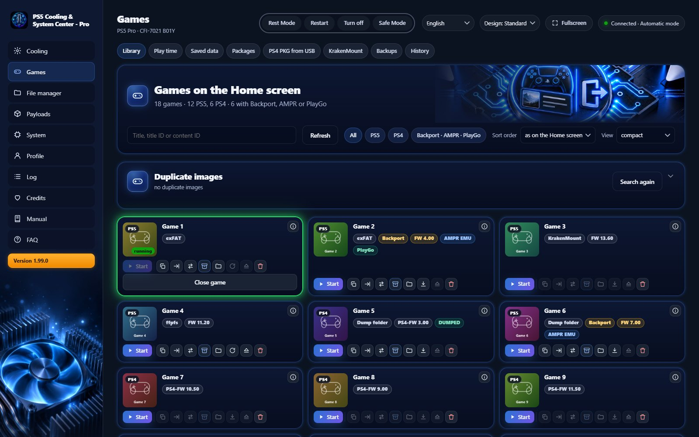</td>
    <td width="50%">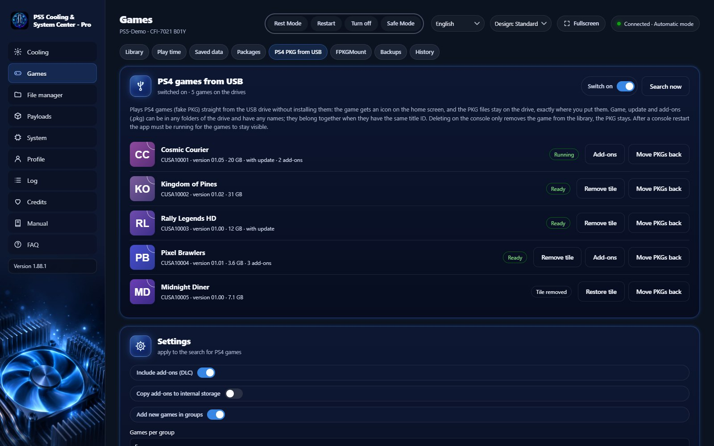</td>
  </tr>
  <tr>
    <td align="center"><sub>Jeux : bibliothèque en vue compacte avec lancer, copier, convertir</sub></td>
    <td align="center"><sub>PS4 PKG depuis USB : faux PKG sans installation</sub></td>
  </tr>
  <tr>
    <td>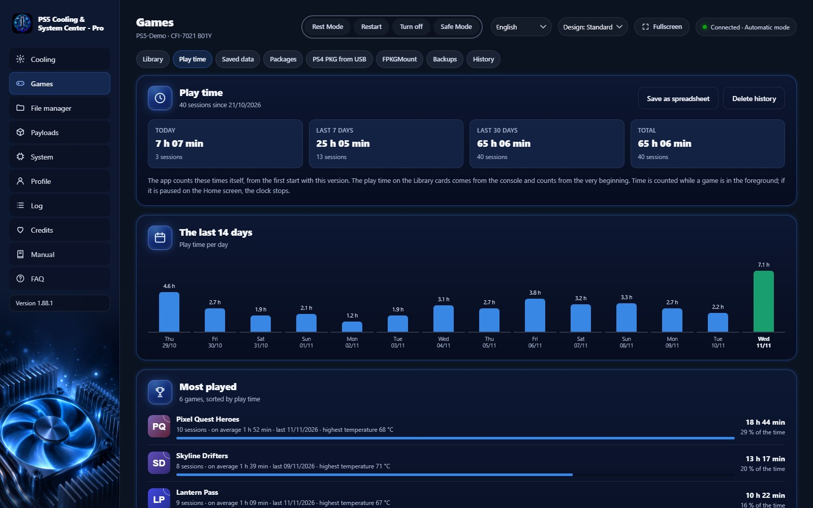</td>
    <td>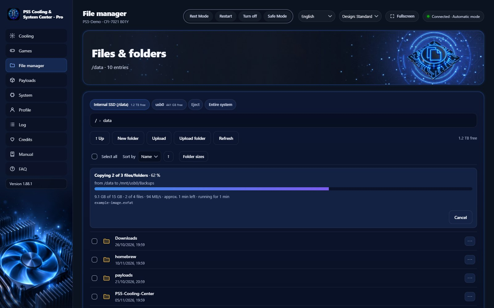</td>
  </tr>
  <tr>
    <td align="center"><sub>Temps de jeu avec graphique journalier et températures</sub></td>
    <td align="center"><sub>Gestionnaire de fichiers pour la console et les disques USB</sub></td>
  </tr>
  <tr>
    <td>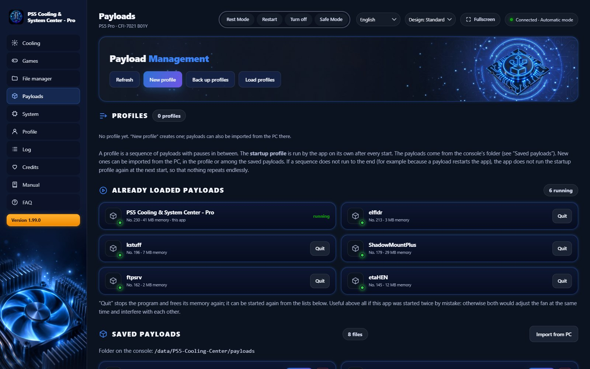</td>
    <td>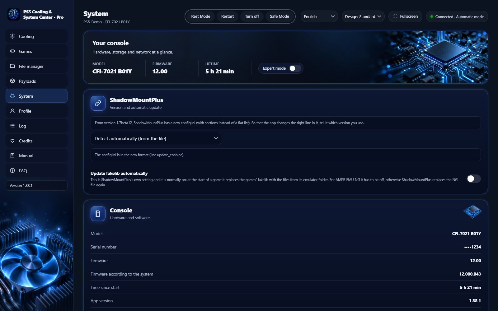</td>
  </tr>
  <tr>
    <td align="center"><sub>Payloads : profils, en cours et enregistrés</sub></td>
    <td align="center"><sub>Système : console, réseau, écran</sub></td>
  </tr>
</table>

<details>
<summary><b>Autres écrans</b> (refroidissement en détail, sauvegardes, paquets, profil, journal, téléphone)</summary>
<br>
<table>
  <tr>
    <td width="50%">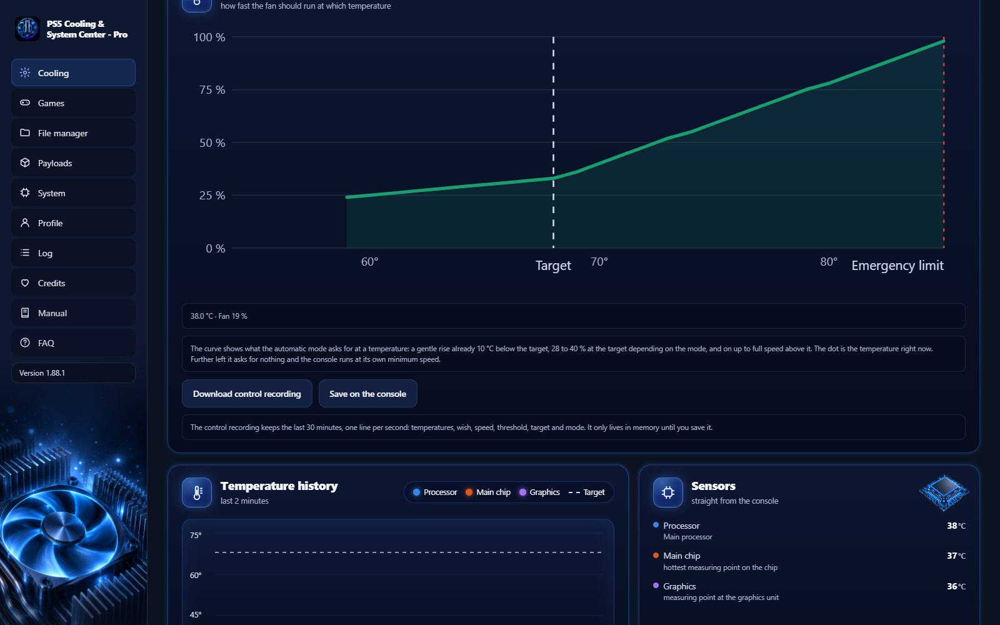</td>
    <td width="50%">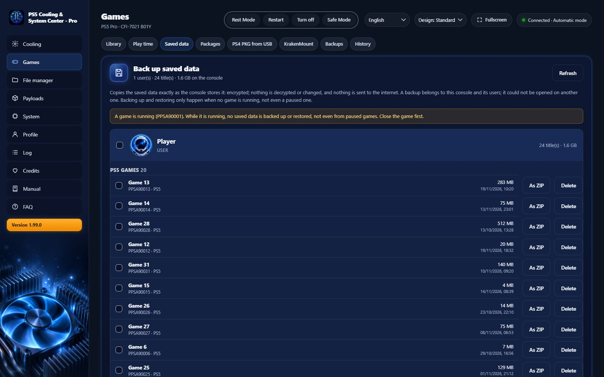</td>
  </tr>
  <tr>
    <td>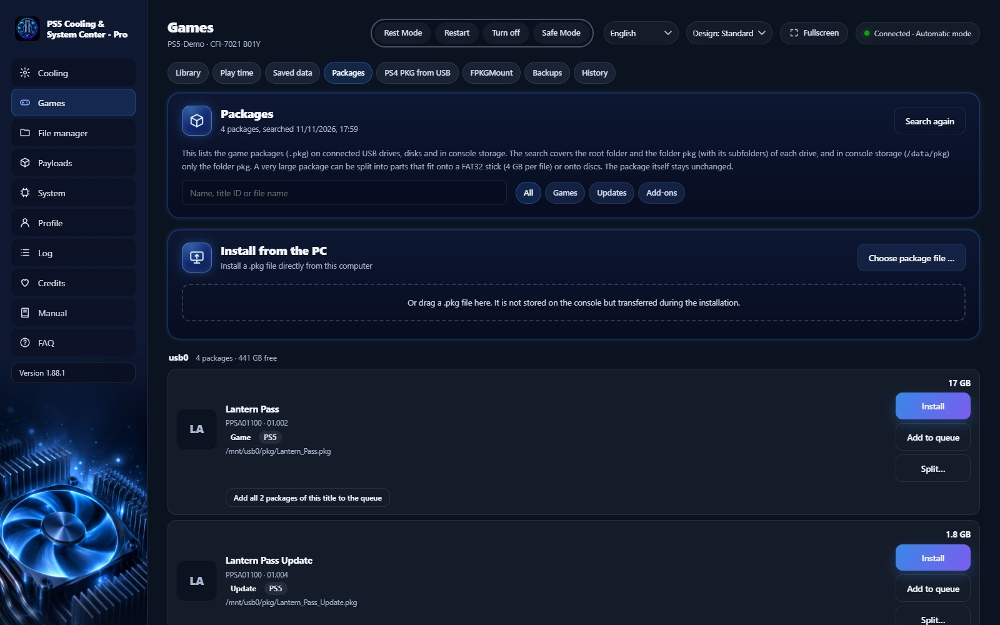</td>
    <td>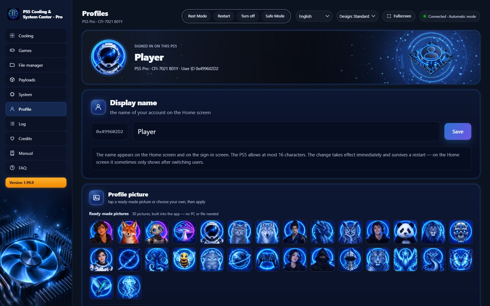</td>
  </tr>
  <tr>
    <td>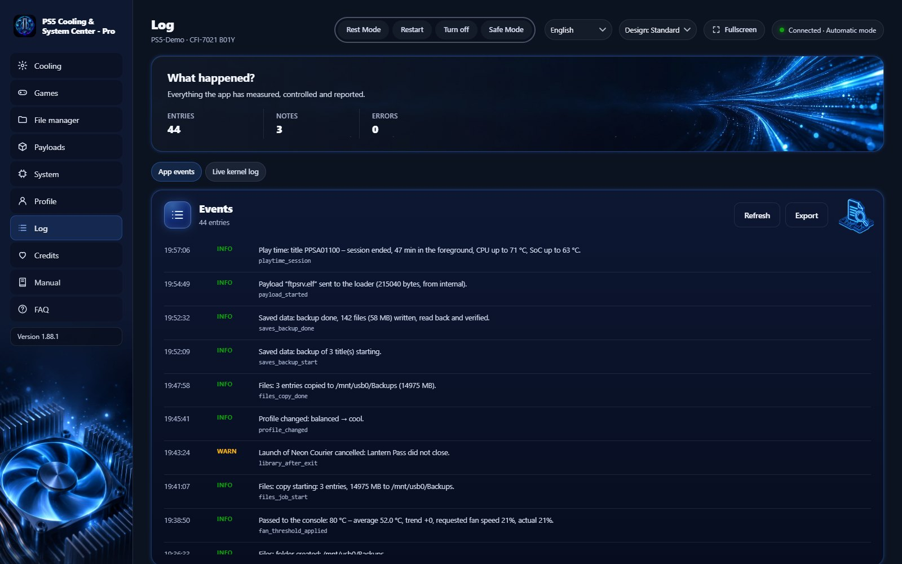</td>
    <td align="center">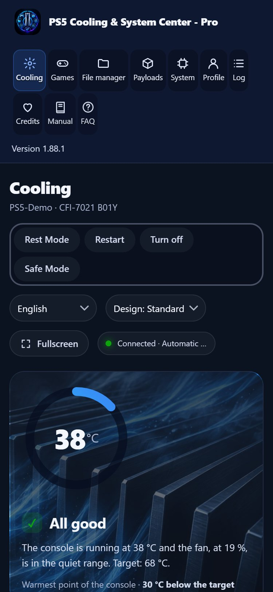</td>
  </tr>
  <tr>
    <td>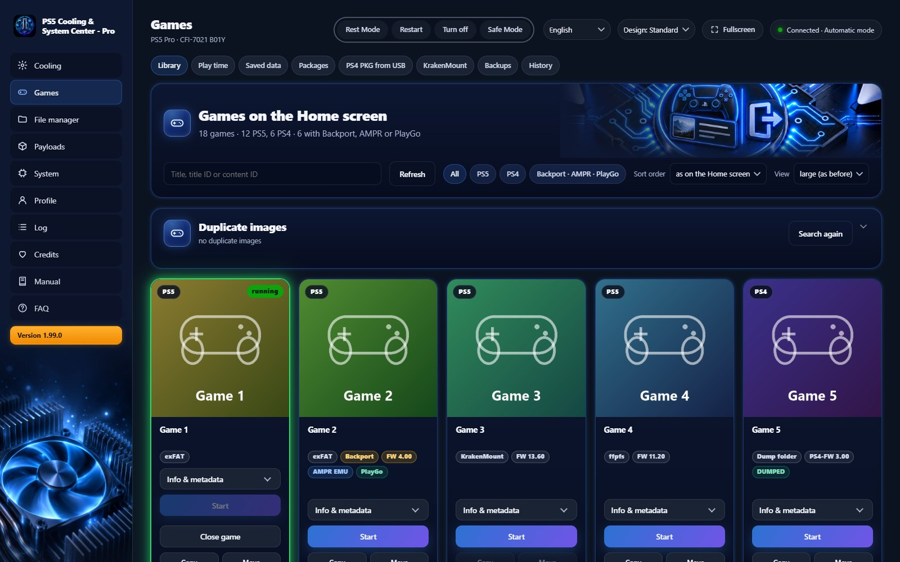</td>
    <td align="center" valign="middle"><sub>Jeux en grande vue (par défaut) : grandes jaquettes, boutons avec libellé (réglable sur la page Jeux)</sub></td>
  </tr>
</table>
<sub>Toutes les images avec des données d'exemple et des jeux inventés, prises avec la version 1.99.0 ; l'interface est montrée en anglais.</sub>
</details>

### Écrans de l'application plein écran

<table>
  <tr>
    <td width="50%">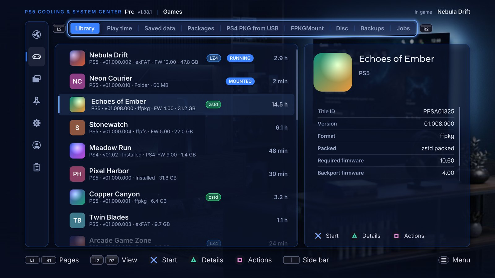</td>
    <td width="50%">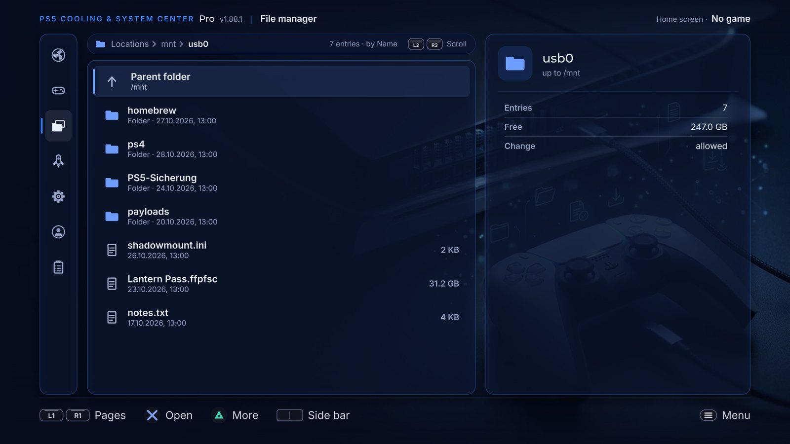</td>
  </tr>
  <tr>
    <td align="center"><sub>Jeux : bibliothèque avec lancement, détails et actions</sub></td>
    <td align="center"><sub>Gestionnaire de fichiers : un dossier du disque USB</sub></td>
  </tr>
  <tr>
    <td width="50%">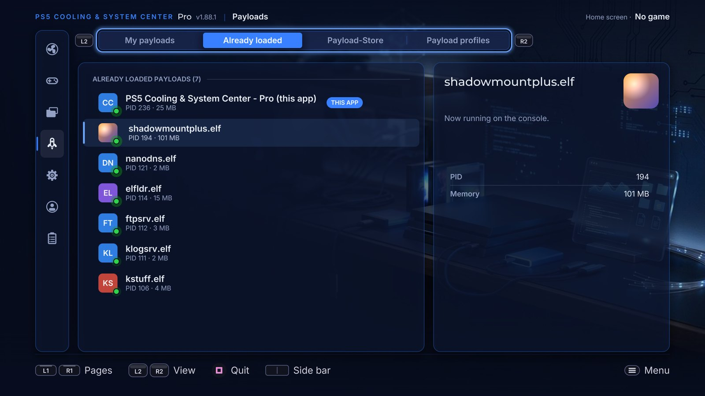</td>
    <td width="50%">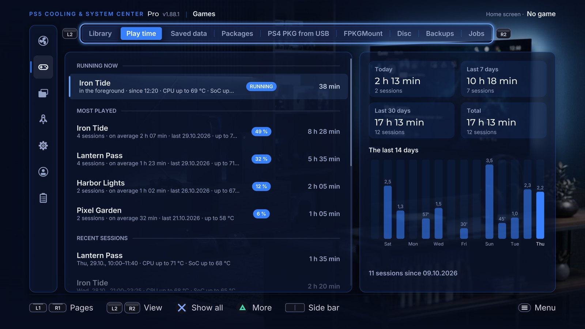</td>
  </tr>
  <tr>
    <td align="center"><sub>Payloads : voir et arrêter ceux en cours</sub></td>
    <td align="center"><sub>Temps de jeu avec aperçu quotidien</sub></td>
  </tr>
</table>
<sub>Toutes les images avec des données d'exemple et des jeux inventés, prises avec la version 1.99.0 ; l'interface est montrée en anglais.</sub>

<details>
<summary><b>Toutes les fonctions en détail</b></summary>

**Refroidissement**
- Maintient une température cible (66 °C par défaut, réglable de 50 à 91 °C) avec moyenne glissante, zone morte et tendance, et ne change la vitesse que par petits pas.
- Modes silencieux, équilibré et frais, choix rapides et règles par jeu.
- À partir de la température de sécurité (78 °C par défaut), le ventilateur monte franchement ; un gardien du ventilateur distinct le rend à la console si la régulation se bloque et maintient le refroidissement maximal en cas de surchauffe. Sans l'appli, la console régule seule.
- Mode nuit : entre deux heures, une cible plus silencieuse s'applique ; l'heure est celle de l'appareil sur lequel la page est ouverte.
- Auto-test du ventilateur d'un bouton et vitesse minimale apprise de la console (20 % au repos, 34 % en jeu), affichée dans le diagnostic.

**Jeux**
- Lancer (depuis le navigateur de la console la page se ferme aussitôt), fermer, supprimer (demande d'abord), déplacer ou décompresser avec ShadowMountPlus ; copier vers un autre disque comme jeu pour ShadowMountPlus (`homebrew`), pour Kraken Mount (`Kraken-Games`) ou comme copie de sécurité.
- Convertir en images exFAT, ffpkg et ffpfsc sans PC (les trois mêmes destinations) ; tout est relu et vérifié, avec un fichier `.sha256`, et les exécutables PS5 non signés reçoivent une fausse signature. En plus, un FPKG de débogage (`.pkg`) pour Kraken Mount, écrit par le Dump Forge intégré (quer3q).
- Paquets LZ4 et zstd, index AMPR, APR-EMU (ampr_emu et AMPR EMU NG), stub PlayGo et modules DLC par jeu ; vérifier, décompresser et réparer des images.
- PS4 PKG depuis USB : faux PKG PS4 d'un disque USB dans la bibliothèque sans installation (PS4Mount de gasb07 ; désactivé par défaut).
- KrakenMount : jouer des FPKG, des dossiers de jeu et des images depuis les dossiers `Kraken-Games` sans installation, avec Kraken Mount de quer3q (intégré, désactivé par défaut). Quand ShadowMountPlus ne tourne pas, il joue aussi ses dossiers (`homebrew`, `etaHEN/games`) ; un voyant dans l'onglet indique quel programme les détient.
- Disc : indique quel disque est dans le lecteur (PS2/PS3/PS4/PS5, ID de titre), crée une image des DVD PS2 et des disques PS3 avec CRC-32, MD5 et SHA-1, vérifiée avec Redump si on le souhaite (d'après ps-disc-detect), et copie (dump) sur un disque, comme sauvegarde, les jeux PS5 et PS4 installés depuis un disque.
- Temps de jeu avec températures, sauvegarde et restauration des données de jeu, trouver, découper et installer des paquets, historique de toutes les tâches.

**Gestion**
- Gestionnaire de fichiers : afficher, modifier, télécharger et téléverser (dossiers entiers compris), créer des dossiers, renommer, copier, déplacer, supprimer – partout, avec débit et temps restant pendant la copie ; la suppression demande d'abord confirmation et nomme ce qui disparaît. Recherche par nom dans le dossier ou en dessous (sur tout le lecteur aussi), et les dossiers portant un ID de titre affichent le titre du jeu.
- Lecteurs NTFS (Windows) : lire et écrire les clés et disques NTFS dans le gestionnaire de fichiers (téléverser, créer des dossiers, copier, déplacer, supprimer ; sans renommer ni remplacer), éjecter sans ShadowMountPlus (pilote de PS5-NTFS-BROWSER d’abcde6543).
- Payloads : voir et arrêter ceux en cours, lancer ses propres `.elf` depuis un dossier ou une clé USB, profils comme séquence de démarrage ; télécharger et mettre à jour les payloads de la liste du Payload Manager d'itsPLK et de celle de strongt1me (vérification SHA-256).
- Profil : nom affiché et image de profil (30 images intégrées ou un fichier personnel) ; activer un compte hors ligne (comme OffAct) et écrire une fausse connexion (np-fake-signin d'earthonion).
- Thème : standard, clair, sombre et optimal (le plus rapide à dessiner, pensé pour le téléviseur) ; chaque appareil retient son choix.
- Système : modèle, firmware, durée de fonctionnement, stockage, réseau ; capteurs bruts et diagnostic en mode expert.
- En-tête sur chaque page : mode repos, redémarrer, éteindre, mode sans échec (un clic chacun).

**Technique**
- Serveur HTTP maison sans bibliothèque tierce, [interface JSON](docs/API.md) documentée, réglages dans `/data/PS5-Cooling-Center/config.json`.
- Aucun accès à Internet, sauf sur appui d'un bouton : « Télécharger des payloads » et les boutons pour une version plus récente d'AMPR EMU NG, de Kraken Mount ou de Dump Forge téléchargent depuis GitHub. Pour le reste, l'appli ne parle qu'aux programmes de la console et aux navigateurs de votre réseau local.

</details>

## Démarrage rapide

1. Télécharger `PS5_Cooling_System_Center_v<version>.elf` depuis les [Releases](../../releases).
2. L'envoyer à la console (chargeur ELF, port **9021**), par exemple :
   ```bash
   nc -q0 <IP-PS5> 9021 < PS5_Cooling_System_Center_v1.99.0.elf
   ```
3. Ouvrir **`http://<IP-PS5>:8086`** dans un navigateur (la notification en haut à gauche de la TV affiche aussi l'adresse).

> [!TIP]
> **Démarrer sans envoyer :** décompressez `FAKE86921.zip` (appli plein écran avec la manette) et/ou `FAKE86922.zip` (interface web dans le navigateur) depuis la release et copiez les dossiers dans `/data/homebrew/`. ShadowMountPlus (sans lui, Kraken Mount s'il est activé) crée les tuiles ; un appui démarre l'appli.

> [!IMPORTANT]
> Une seule **instance** à la fois, sinon deux programmes se disputent le ventilateur. Une ancienne instance s'arrête sur la page « Payloads ». Plus dans le [LIESMICH](docs/LIESMICH.txt) (en allemand).

## Prérequis

| | |
| --- | --- |
| **Console** | PS5 jailbreakée avec un chargeur ELF sur le port 9021 ([elfldr](https://github.com/ps5-payload-dev/elfldr) ou équivalent) |
| **Firmware** | **Prise en charge de FW 1.00 à 14.22** |
| **Testé** | PS5 Pro (CFI-7021) et PS5 Slim (CFI-2116), firmware 12.00 ; plusieurs utilisateurs signalent que 4.xx à 10.xx et 13.60 fonctionnent aussi |
| **Ventilateur** | [kstuff](https://github.com/EchoStretch/kstuff-lite) (sans lui, capteurs et interface fonctionnent, pas la régulation) |
| **Réseau** | Un navigateur sur le même réseau, ou le navigateur de la console |
| **Optionnel** | [ShadowMountPlus](https://github.com/drakmor/ShadowMountPlus) pour déplacer, décompresser et les vignettes de lancement ; sans lui, le Kraken Mount intégré joue ses dossiers |

<details>
<summary>Firmware et SDK en détail</summary>

L'ELF est compilé avec le PS5 payload SDK **v0.50**, dont le code de démarrage connaît tous les firmwares **de 1.00 à 14.22**. Un firmware que le code de démarrage ne connaît pas n'atteint jamais `main()` : le programme ne démarre pas du tout et n'écrit rien dans le journal. La température du GPU n'existe que sur la Pro.
</details>

## Utilisation

| Page | Contenu |
| --- | --- |
| **Refroidissement** | État, historique, capteurs, température cible, mode, profils par jeu avec suggestions |
| **Jeux** | Bibliothèque, temps de jeu, sauvegardes, paquets, PS4 PKG depuis USB, KrakenMount, Disc (avec lecteur), copies, historique |
| **Gestionnaire de fichiers** | Dossiers de la console et des disques (NTFS aussi), recherche |
| **Payloads** | Payloads en cours, enregistrés et sur USB, profils, télécharger des payloads |
| **Système** | Console, stockage, réseau, diagnostic |
| **Profil** | Nom affiché, image de profil, compte hors ligne, fausse connexion |
| **Journal** | Événements de l'appli et journal du noyau en direct |
| **Crédits** | Remerciements ; plus le **manuel** et la **FAQ** en sept langues |

**À la manette (navigateur de la console) :** L1 / R1 page précédente / suivante · L2 / R2 défiler vers le haut / bas · Muet deux fois : température et ventilateur sur la TV.

> [!WARNING]
> L'interface **n'a pas de connexion** : tout appareil du réseau domestique peut lire et modifier. Ne configurez pas de redirection du port 8086. Pour n'autoriser que le navigateur de la console, mettez `bind_address` à `127.0.0.1`. Détails dans le [manuel](docs/HANDBUCH.md#zugriff-und-sicherheit-im-heimnetz) et la [politique de sécurité](SECURITY.md).

## Documentation

| Document | Contenu |
| --- | --- |
| [Manuel](docs/HANDBUCH.md) | Utilisation en détail (en allemand ; aussi dans l'appli, en sept langues) |
| [API](docs/API.md) | Tous les points d'accès et champs de configuration |
| [Développement](docs/ENTWICKLUNG.md) | Compiler, envoyer, dépanner, structure du code |
| [Modifications](CHANGELOG.md) | Ce qui a changé dans chaque version |
| [Journal des décisions](docs/ERWEITERUNGEN.md) | Pourquoi les choses sont ainsi, ce qui a été mesuré |
| [Composants tiers](THIRD_PARTY_NOTICES.md) | Code repris et ses licences |
| [Contribuer](CONTRIBUTING.md) · [Sécurité](SECURITY.md) | Contributions et signalement de failles |

<details>
<summary><b>Compiler depuis le code source</b></summary>

Il faut le [PS5 payload SDK](https://github.com/ps5-payload-dev/sdk) **v0.50** ; la compilation vérifie qu'il connaît chaque firmware de 1.00 à 14.22 et s'arrête sinon. Sous Windows, Git Bash avec GNU Make et LLVM 21 suffit :

```bash
tools/build-windows.sh
```

Sous Linux ou WSL :

```bash
export PS5_PAYLOAD_SDK=$HOME/ps5sdk/sdk
make
```

Le résultat est `PS5_Cooling_Center.elf` ; `tools/make_starter.sh` crée les deux vignettes (WSL nécessaire). Le reste est dans [docs/ENTWICKLUNG.md](docs/ENTWICKLUNG.md).
</details>

## Mentions légales et clause de non-responsabilité

> [!CAUTION]
> **Pas un produit officiel, pas de piratage, aucune responsabilité.** Ce projet n'a aucun lien avec les détenteurs des droits de la console. Il ne contient ni jeux, ni firmware, ni clés de tiers (seulement une clé publiquement connue pour des paquets de test créés soi-même, voir THIRD_PARTY_NOTICES.md) ; le dump (onglet Disc) permet seulement à votre propre console de déchiffrer les jeux qui y sont installés, pour une sauvegarde. Il ne télécharge rien depuis Internet sauf, sur appui d'un bouton, les listes de payloads avec leurs fichiers et des versions plus récentes d'AMPR EMU NG, de Kraken Mount et de Dump Forge depuis GitHub. Modifier une console peut coûter la garantie et le compte ; le risque est pour qui le fait. Le programme est fourni **sans aucune garantie**.

<details>
<summary>Texte complet</summary>

> Cette section est une information générale et non un conseil juridique. Toute personne utilisant le projet est responsable de s'assurer que son usage est autorisé dans son pays et vis-à-vis de ses partenaires contractuels.

- **Pas un produit officiel.** « PlayStation », « PS5 » et les logos associés sont des marques de leurs détenteurs respectifs. Ce projet n'a aucun lien avec eux et n'est ni soutenu ni approuvé par eux. Les autres noms appartiennent à leurs propriétaires respectifs.
- **Ta console, ta responsabilité.** Le programme ne fonctionne que sur une console modifiée par son propriétaire. La modification peut enfreindre les conditions d'utilisation et entraîner la perte de la garantie ou le blocage du compte ou de la console, et dans certains pays des suites juridiques. Le risque est pour qui modifie la console et utilise ce programme.
- **Pas de piratage.** Ce projet n'est **pas** fait pour obtenir, diffuser ou utiliser des copies pirates, et ne le soutient pas. Copier, déplacer et convertir n'agissent que sur des jeux déjà présents sur ta console et servent aux sauvegardes de jeux acquis légalement. Trouver, découper, installer et monter des paquets depuis USB n'agissent que sur des paquets que tu as toi-même mis sur la console ou un disque ; l'appli n'en procure aucun. Diffuser des contenus protégés par le droit d'auteur est une infraction dans la plupart des pays. Aucune aide à ce sujet ici, ni dans les issues.
- **Aucun fichier système de tiers dans le dépôt.** Bibliothèques système, firmware et fichiers propriétaires du SDK ne sont ni fournis ni acceptés (voir [CONTRIBUTING](CONTRIBUTING.md)). Les 30 images de profil ont été créées par l'auteur.
- **Aucune garantie, aucune responsabilité.** Le programme intervient sur le contrôle du ventilateur et sur des fonctions système de la console. Il est fourni tel quel, **sans aucune garantie** (GNU GPL, sections 15 et 16). L'auteur n'est pas responsable des dommages aux consoles, données ou comptes. Une console poussiéreuse refroidit moins bien, quelle que soit la régulation du ventilateur.
- **Confidentialité.** Historique, journal et réglages restent sur la console dans `/data/PS5-Cooling-Center/`. L'appli n'envoie aucune donnée sur Internet. La seule exception est dans le navigateur : la page « Credits » charge une fois la petite icône de github.com pour voir si le navigateur a Internet ; seulement alors les liens sont cliquables.
- **Les projets tiers** sont sous leurs propres licences, voir [THIRD_PARTY_NOTICES.md](THIRD_PARTY_NOTICES.md).
</details>

## Contribuer et signaler des bugs

Bugs et souhaits sont les bienvenus en [issue](../../issues), avec modèle de console, firmware, version et le journal exporté (page « Journal »). Contributions : [CONTRIBUTING.md](CONTRIBUTING.md). Merci de signaler les failles de sécurité comme décrit dans [SECURITY.md](SECURITY.md).

## Crédits et remerciements

Ce projet repose sur les épaules de la communauté homebrew PS5. **Merci !** Un remerciement tout particulier à **[Gezine](https://github.com/Gezine)** : sans le travail de Gezine, aucun homebrew ne tournerait sur beaucoup de consoles, et donc cette appli non plus.

<details>
<summary><b>Plateforme et outils</b></summary>

- **John Törnblom et tous les contributeurs de [ps5-payload-dev](https://github.com/ps5-payload-dev)** : le [PS5 payload SDK](https://github.com/ps5-payload-dev/sdk), le chargeur [elfldr](https://github.com/ps5-payload-dev/elfldr), [klogsrv](https://github.com/ps5-payload-dev/klogsrv), [ftpsrv](https://github.com/ps5-payload-dev/ftpsrv), [websrv](https://github.com/ps5-payload-dev/websrv) et [OffAct](https://github.com/ps5-payload-dev/offact) (activation de comptes hors ligne, portée en C).
- **Les développeurs de kstuff** : [sleirsgoevy](https://github.com/sleirsgoevy), [EchoStretch](https://github.com/EchoStretch) et [drakmor](https://github.com/drakmor) ([kstuff-lite](https://github.com/EchoStretch/kstuff-lite)). Sans kstuff, pas d'accès au contrôleur du ventilateur.
</details>

<details>
<summary><b>Code d'autres projets (porté ou intégré)</b></summary>

- **[gasb07](https://github.com/gasb07), [PS4Mount](https://github.com/gasb07/ps4mount)** (GPL-3.0) : faux PKG PS4 PKG depuis USB sans installation ; le code est intégré comme onglet « PS4 PKG depuis USB ».
- **[RenanGBarreto](https://github.com/RenanGBarreto), [rdmrocha](https://github.com/rdmrocha) et les contributeurs de [MkPFS](https://github.com/PSBrew/MkPFS)** ([PSBrew](https://github.com/PSBrew), GPL-3.0) : images exFAT, PFS et PFSC.
- **[SvenGDK](https://github.com/SvenGDK), [UFS2Tool](https://github.com/SvenGDK/UFS2Tool)** (BSD-2-Clause) : modèle de l'écriture UFS2/ffpkg.
- **[drakmor](https://github.com/drakmor)** : [ampr_emu](https://github.com/drakmor/ampr_emu) (asset packs LZ4, APR-EMU), [pgo_stub](https://github.com/drakmor/pgo_stub) et [dlc_emu](https://github.com/drakmor/dlc_emu) (versions intégrées, GPL-3.0).
- **[quer3q](https://github.com/quer3q)** (GPL-3.0-or-later) : [AMPR EMU NG](https://github.com/quer3q/ampr-emu-ng), une évolution d'ampr_emu qui lit aussi les paquets zstd (0.5.1 et 0.5.0 intégrées, les plus récentes sur demande) ; [Kraken Mount](https://github.com/quer3q/kraken-mount), le programme derrière l'onglet « KrakenMount » (intégré, modifié de quelques octets pour fonctionner à côté de ShadowMountPlus) ; [Dump Forge](https://github.com/quer3q/ps5-dump-forge), le moteur du FPKG et de la compression lors de la conversion (intégré tel quel). Les paquets zstd et la fausse signature de l'appli suivent leurs formats.
- **BlackBearReloaded, ps5-homebrew-ui, ps5-opengl et ps5-native-app-boilerplate** (GPL-3.0) : l'appli plein écran est construite sur ps5-homebrew-ui (à partir de la copie conservée par [JMUtechnologies](https://github.com/JMUtechnologies/ps5-homebrew-ui)), la vignette du navigateur d'après le boilerplate.
- **[itsPLK](https://github.com/itsPLK), [ps5-pkg-manager](https://github.com/itsPLK/ps5-pkg-manager)** (GPL-3.0) : structure des paquets et déroulement de l'installation (code propre sur ce modèle).
- **[phantomptr](https://github.com/phantomptr), [ps5upload](https://github.com/phantomptr/ps5upload)** (GPL-3.0) : fonction profil et format de l'image de profil.
- **[EchoStretch](https://github.com/EchoStretch) et slopmaster33, [ps5-app-dumper](https://github.com/EchoStretch/ps5-app-dumper)** 2.10 (GPL-3.0-or-later) : la base du dump dans l'onglet Disc, reprise et réécrite pour l'appli (avec le self pager d'[idlesauce](https://github.com/idlesauce), structures SELF d'après PS5-SELF-Decrypter de Cryptogenic).
- **slopmaster33, webhb** (GPL-3.0) : encodeur QR.
- **[danthespal](https://github.com/danthespal), [MkPFS.CSharp](https://github.com/danthespal/MkPFS.CSharp)** (GPL-3.0) : les quatre profils LZ4 testés (ASTRO BOT, EA Sports UFC 6, moteur d'Insomniac, moteur Unity), intégrés sans modification.
- **[Knutwurst](https://github.com/knutwurst), [PatchDL](https://github.com/knutwurst/ps5-patchdl)** (GPL-3.0) : la résolution de noms propre à l'appli et le téléchargement HTTPS (pour les téléchargements depuis GitHub).
- **[abcde6543](https://github.com/abcde6543), [PS5-NTFS-BROWSER](https://github.com/abcde6543/PS5-NTFS-BROWSER)** (GPL-3.0-or-later): le pilote NTFS (lecture et écriture) derrière les lecteurs NTFS du gestionnaire de fichiers, intégré (v1.4.0) avec des contrôles ajoutés, un cache d'écriture et la gestion du journal.
- **[BearSSL](https://bearssl.org/)** 0.6 (Thomas Pornin, MIT) : TLS pour les téléchargements depuis GitHub.
- **[Eric Biggers](https://github.com/ebiggers), [libdeflate](https://github.com/ebiggers/libdeflate)** (MIT) · **[Dave Gamble](https://github.com/DaveGamble), [cJSON](https://github.com/DaveGamble/cJSON)** (MIT) · **[LZ4](https://github.com/lz4/lz4)** (BSD-2-Clause) · **[zstd](https://github.com/facebook/zstd)** (BSD-3-Clause) · **[SQLite](https://sqlite.org/)** (domaine public) · **stb_image** (Sean Barrett, domaine public ou MIT ; appli plein écran).
</details>

<details>
<summary><b>Collaboration, savoir et modèles</b></summary>

- **[drakmor](https://github.com/drakmor)** : [ShadowMountPlus](https://github.com/drakmor/ShadowMountPlus) (monter, déplacer, décompresser des jeux) et [ps5-hwinfo](https://github.com/drakmor/ps5-hwinfo) (rails d'alimentation, fréquences).
- **V-10, [exFAT2AMPR](https://github.com/exFAT2AMPR/exfat2ampr)** : liste pour « Automatique », enregistrement pour créer des profils, entretien des plugins de jeux.
- **theghostonline (Husam Osman), PS5 LZ4 Compression** : fichiers qui doivent rester séparés à l'empaquetage, droits 0777, réparation lors de la vérification des paquets, choix des profils testés.
- **[kerrdec97](https://github.com/kerrdec97), [exFAT Image Builder](https://github.com/kerrdec97/ps5-exfat-builder)** : paramètres des images `.ffpkg`.
- **[itsPLK](https://github.com/itsPLK)** : [ps5-unified-autoloader](https://github.com/itsPLK/ps5-unified-autoloader) et [Payload Manager](https://github.com/itsPLK/ps5-payload-manager) (modèle et liste pour « Télécharger des payloads », [ps5-payloads-mirror](https://github.com/itsPLK/ps5-payloads-mirror)).
- **[StonedModder](https://github.com/StonedModder), [ps-game-state-lib](https://github.com/StonedModder/ps-game-state-lib)** (MIT) : détection du jeu en cours.
- **[earthonion](https://github.com/earthonion), [Garlic SaveMgr](https://github.com/earthonion/garlic-savemgr)**: modèle pour transférer des sauvegardes vers une autre console (format du fichier ZIP avec `chives.json`, voie par le montage propre de la console) ; le code de cette application est réécrit. En plus, np-fake-signin 1.3, intégré tel quel pour la fausse connexion.
- **[etaHEN](https://github.com/etaHEN/etaHEN)** et **[onionHEN](https://github.com/aydencharles/onionHEN)** : appels système, mesures, images/s.
- **[Soniciso](https://git.etawen.dev/soniciso), [Elf Arsenal](https://git.etawen.dev/soniciso/elf-arsenal)** : modèle de nombreuses fonctions (code réécrit à chaque fois).
- **BestPig, [BackPork](https://github.com/BestPig/BackPork)** : le principe des bibliothèques de remplacement.
- **Juma Sayeh et Osama Abualia, PS5 Game Compressor** : idées pour vérifier et convertir (tout réécrit ; son code n'a pas de licence).
- **PS4FFPFSC** 0.2.9 (GPL-3.0-or-later) : modèle de ce dont un dossier de jeu PS4 a besoin pour devenir une image (réécrit en C).
- **Transmission pour PS5** (GPL-3.0-or-later) : modèle pour deux sécurités à l'éjection (qui a encore des fichiers ouverts sur le disque, une éjection qui n'est pas revenue).
- **[Daniel Nylander](https://github.com/yeager)** : la traduction suédoise de l'interface web.
- **Pilote Linux `hid-playstation`** (batterie de la DualSense) · **Xbox 360 DashLaunch** (l'idée d'une régulation calme) · **ps-disc-detect** (modèle pour l'onglet Disc).
</details>

<details>
<summary><b>Merci à la communauté</b></summary>

Leur code n'est pas dans cette appli, mais sans leur travail partagé la scène n'existerait pas ainsi : [owendswang](https://github.com/owendswang), [LightningMods](https://github.com/LightningMods), [Andy Nguyen / TheFloW](https://github.com/TheOfficialFloW), [Specter](https://github.com/Cryptogenic), [ChendoChap](https://github.com/ChendoChap), [flatz](https://github.com/flatz), [Al Azif](https://github.com/Al-Azif), [zecoxao](https://github.com/zecoxao), [ArkSama](https://github.com/ArkSama), [nexgen999](https://github.com/nexgen999), [matem6](https://github.com/matem6), [Phoenixx1202](https://github.com/Phoenixx1202), [SiSTR0](https://github.com/SiSTR0) – et tous les autres qui contribuent par du code, des tests, des guides ou des réponses. Dans l'appli, tous figurent avec une image sur la page « Crédits ».
</details>

Si vous ne vous trouvez pas ici ou êtes mal décrit, signalez-le : la liste sera volontiers complétée.

## Licence

Copyright © 2026 strongt1me · **GNU General Public License v3.0 ou ultérieure**, voir [LICENSE](LICENSE). Jusqu'à 1.45.1 le projet était sous MIT ; depuis 1.46.0 il est sous GPL-3.0-or-later car il reprend des parties de projets GPL (détails dans [THIRD_PARTY_NOTICES.md](THIRD_PARTY_NOTICES.md)).

<sub>Ce README existe aussi en [Deutsch](README.de.md), [English](README.md), [Italiano](README.it.md), [Español](README.es.md), [Русский](README.ru.md) et [Svenska](README.sv.md). Le manuel et la FAQ accompagnent chaque release dans les sept langues.</sub>
