<div align="center">

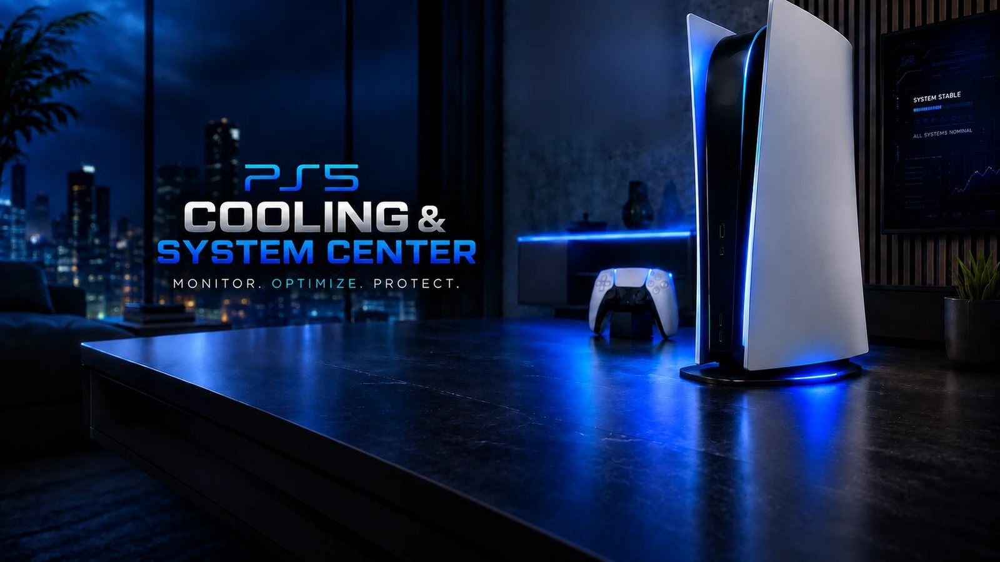

# PS5 Cooling & System Center - Pro

**Fläktstyrning, temperaturövervakning och systemcentral för den jailbreakade PlayStation 5,<br>som används i en webbläsare (konsol, mobil, dator) eller som helskärmsapp på TV:n med handkontrollen, på sju språk.**


[Funktioner](#funktioner) · [Snabbstart](#snabbstart) · [Krav](#krav) · [Användning](#användning) · [Dokumentation](#dokumentation) · [Juridiskt](#juridisk-information-och-ansvarsfriskrivning) · [Medverkande](#medverkande-och-tack)

[Deutsch](README.md) · [English](README.en.md) · [Italiano](README.it.md) · [Español](README.es.md) · [Français](README.fr.md) · [Русский](README.ru.md) · **Svenska**

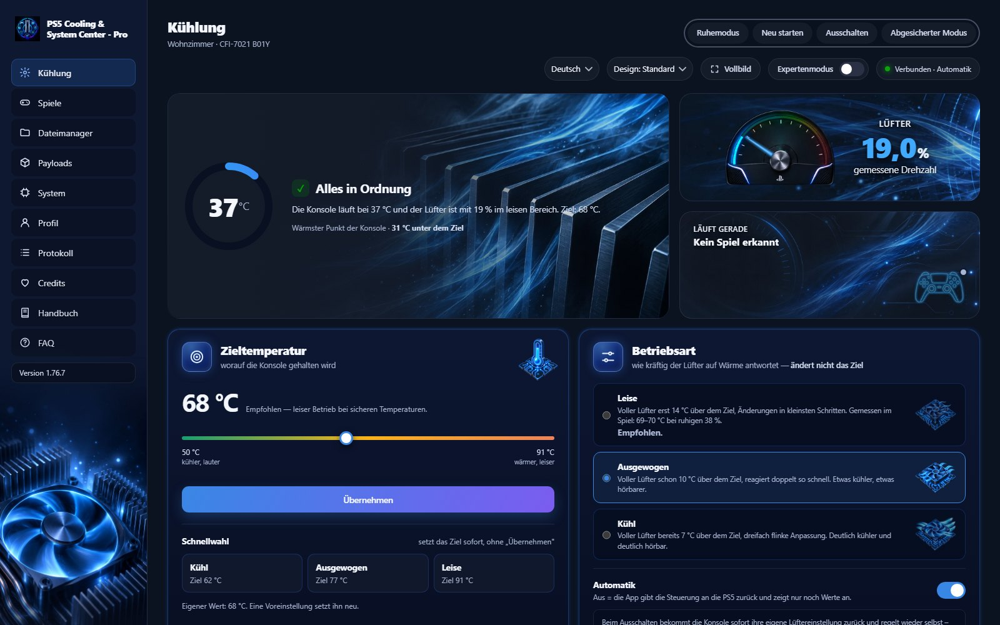

</div>

En homebrew-payload (ELF) som läser PS5:ans temperatursensorer, styr fläkten längs en tyst, justerbar komfortkurva och levereras med en webbapp och en helskärmsapp. Dessutom: hantering av spel, filer, payloads och profil. Allt körs på själva konsolen, utan dator och utan internet.

## Två gränssnitt

En app, två sätt att använda den. Helskärmsappen kan nästan allt som webbappen kan; bara att ladda upp och hämta filer går enbart i webbläsaren.

<table>
  <tr>
    <td width="50%"></td>
    <td width="50%">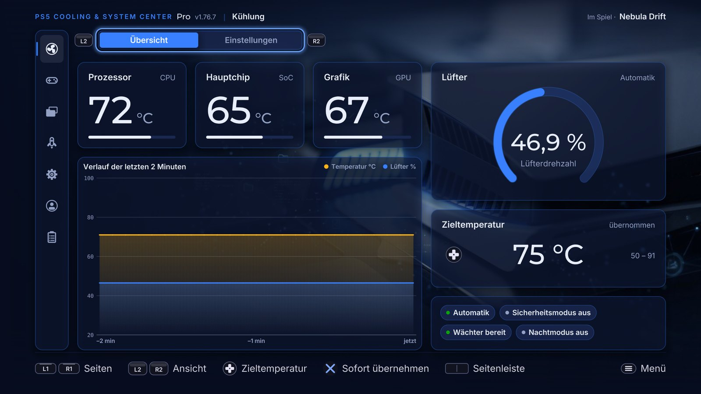</td>
  </tr>
  <tr>
    <td valign="top">
      <h3>🌐 Webbapp</h3>
      I konsolens webbläsare eller från mobil och dator i hemnätverket: <code>http://&lt;PS5-IP&gt;:8086</code>. Som ruta <b>FAKE86922</b> öppnar ett tryck konsolens webbläsare med appen. Fyra teman, sju språk, handbok och FAQ inbyggda.
    </td>
    <td valign="top">
      <h3>📺 Helskärmsapp</h3>
      Rutan <b>FAKE86921</b> i konsolens medieområde fyller TV:n och styrs enbart med handkontrollen, helt utan webbläsare. L1/R1 byter sida, L2/R2 vy, <b>X</b> öppnar eller startar, <b>Triangel</b> visar mer, <b>Fyrkant</b> öppnar åtgärderna.
    </td>
  </tr>
</table>

## Funktioner

<table>
  <tr>
    <td width="33%" valign="top">
      <h3>🌡️ Kylning</h3>
      Tyst fläktstyrning mot en måltemperatur (50–91 °C), driftlägen, profiler per spel, ett tystare mål på natten, ett fläkttest, en säkerhetsgräns som hårdvaran sköter.
    </td>
    <td width="33%" valign="top">
      <h3>📊 Mätvärden</h3>
      Processor, SoC, grafik (Pro), fläkt, kärnbelastning, klockfrekvenser, strömskenor, bildfrekvens och handkontrollens batteri, med historik.
    </td>
    <td width="33%" valign="top">
      <h3>🎮 Spel</h3>
      Starta, stäng, kopiera, flytta, konvertera till exFAT/ffpkg/ffpfsc, LZ4-asset-paket, APR-EMU, PlayGo. Kompakt vy (standard) eller stor.
    </td>
  </tr>
  <tr>
    <td valign="top">
      <h3>💾 PS4 från USB</h3>
      Spela PS4-fake-PKG direkt från en USB-enhet utan installation (PS4Mount inbyggt), med uppdateringar och DLC.
    </td>
    <td valign="top">
      <h3>📦 Paket & spelsparningar</h3>
      Hitta, dela och installera PKG; säkerhetskopiera och återställ spelsparningar; speltid med temperaturer.
    </td>
    <td valign="top">
      <h3>📁 Filer & payloads</h3>
      Filhanterare för konsolen och enheterna; hämta payloads (Payload Managers lista), starta och avsluta dem, ladda dem efter varandra som profiler.
    </td>
  </tr>
  <tr>
    <td valign="top">
      <h3>🖥️ System & logg</h3>
      Modell, firmware, nätverk, skärm; händelselogg och levande kärnlogg med inspelning.
    </td>
    <td valign="top">
      <h3>🕹️ Genvägar på handkontrollen</h3>
      L1/R1 byter sida, L2/R2 rullar; två tryck på Mute visar temperatur och fläkt på TV:n.
    </td>
    <td valign="top">
      <h3>🚀 Startrutor</h3>
      Två mappar för <code>/data/homebrew</code>: <code>FAKE86921</code> startar helskärmsappen, <code>FAKE86922</code> öppnar webbappen.
    </td>
  </tr>
</table>

### Vyer i webbappen

<table>
  <tr>
    <td width="50%">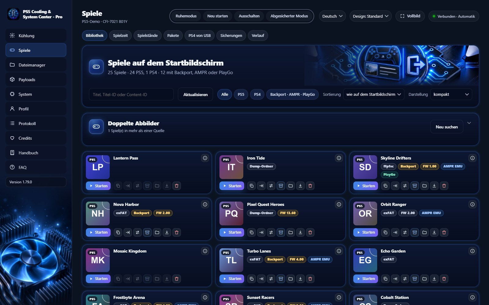</td>
    <td width="50%">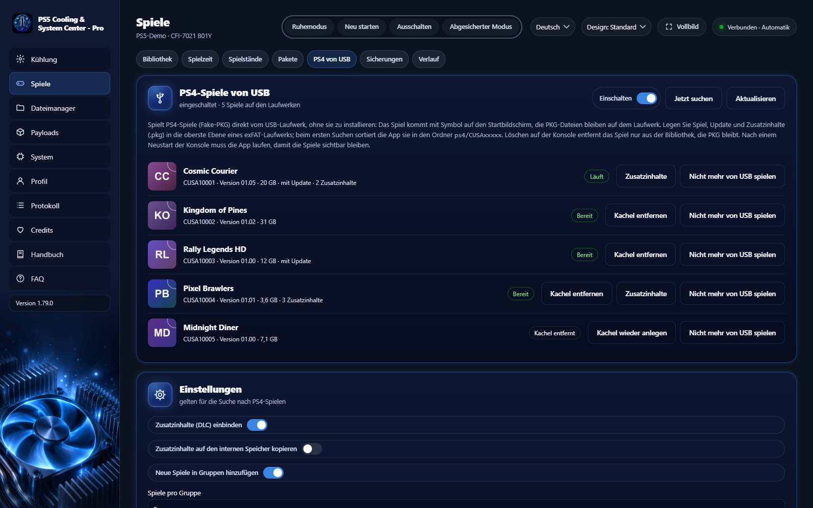</td>
  </tr>
  <tr>
    <td align="center"><sub>Spel: bibliotek i kompakt vy (standard) med start, kopiering, konvertering</sub></td>
    <td align="center"><sub>PS4 från USB: fake-PKG utan installation</sub></td>
  </tr>
  <tr>
    <td>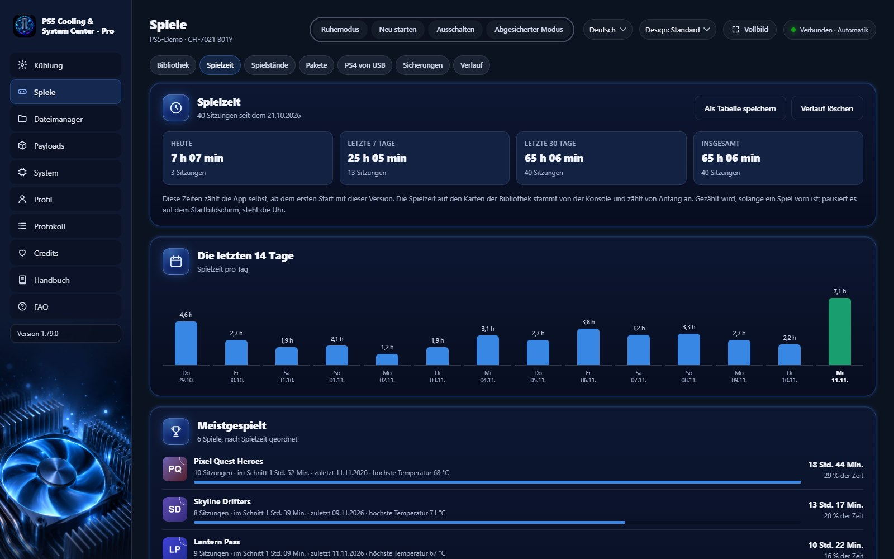</td>
    <td>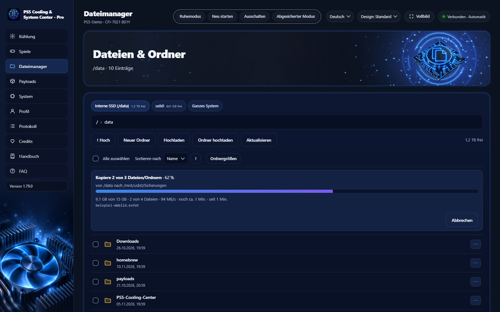</td>
  </tr>
  <tr>
    <td align="center"><sub>Speltid med dagsdiagram och temperaturer</sub></td>
    <td align="center"><sub>Filhanterare för konsolen och USB-enheter</sub></td>
  </tr>
  <tr>
    <td>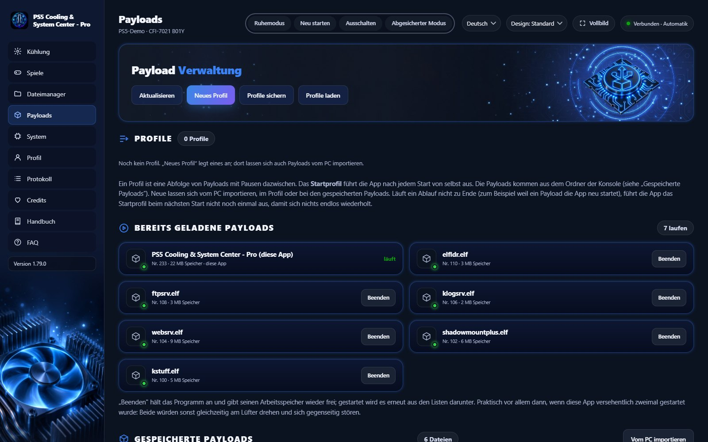</td>
    <td>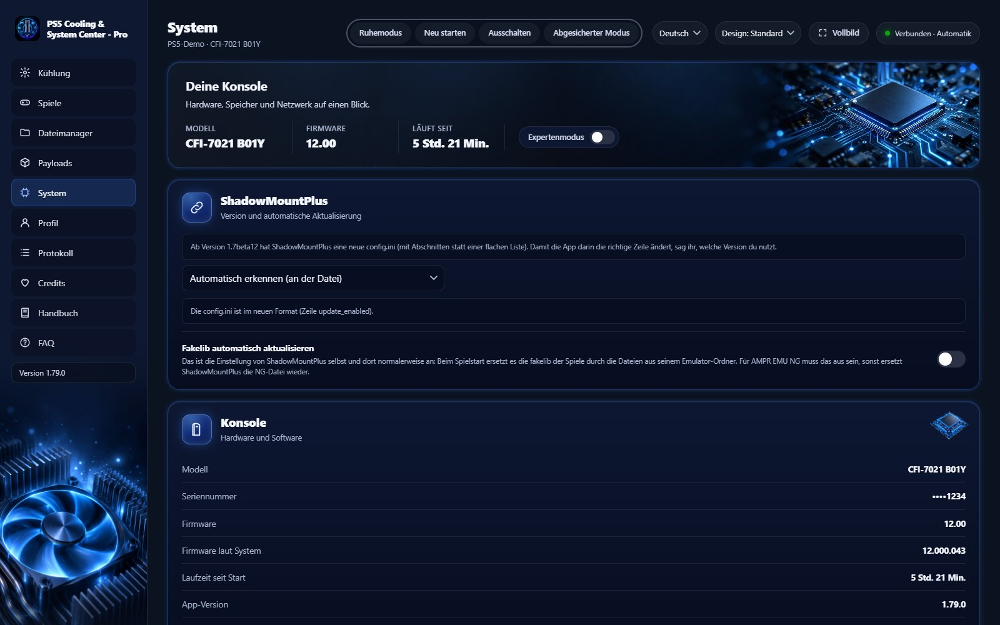</td>
  </tr>
  <tr>
    <td align="center"><sub>Payloads: profiler, pågående och sparade</sub></td>
    <td align="center"><sub>System: konsol, nätverk, skärm</sub></td>
  </tr>
</table>

<details>
<summary><b>Fler vyer</b> (kylning i detalj, spelsparningar, paket, profil, logg, mobil)</summary>
<br>
<table>
  <tr>
    <td width="50%">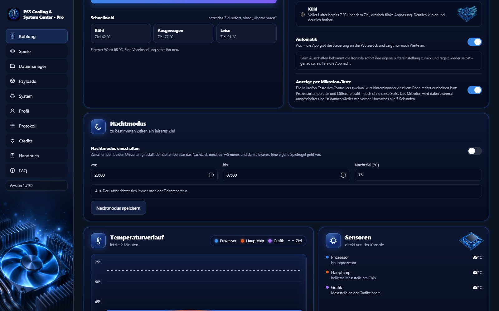</td>
    <td width="50%">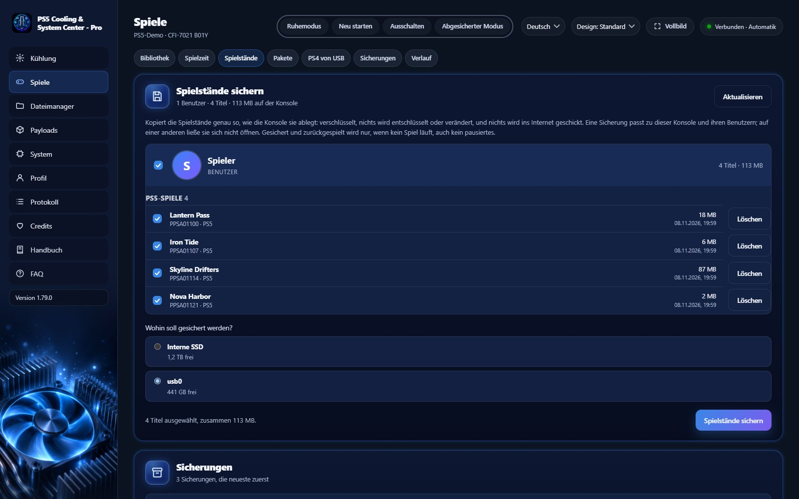</td>
  </tr>
  <tr>
    <td>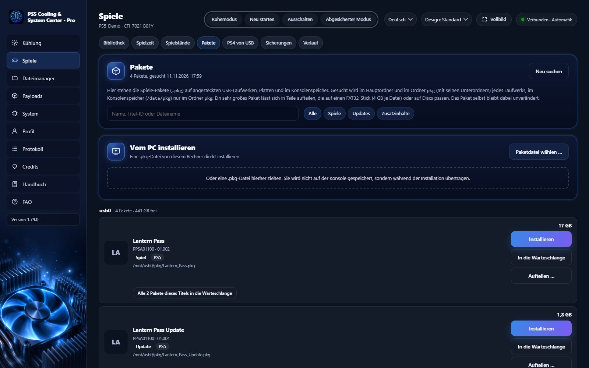</td>
    <td>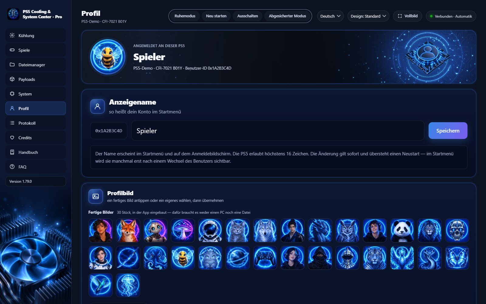</td>
  </tr>
  <tr>
    <td>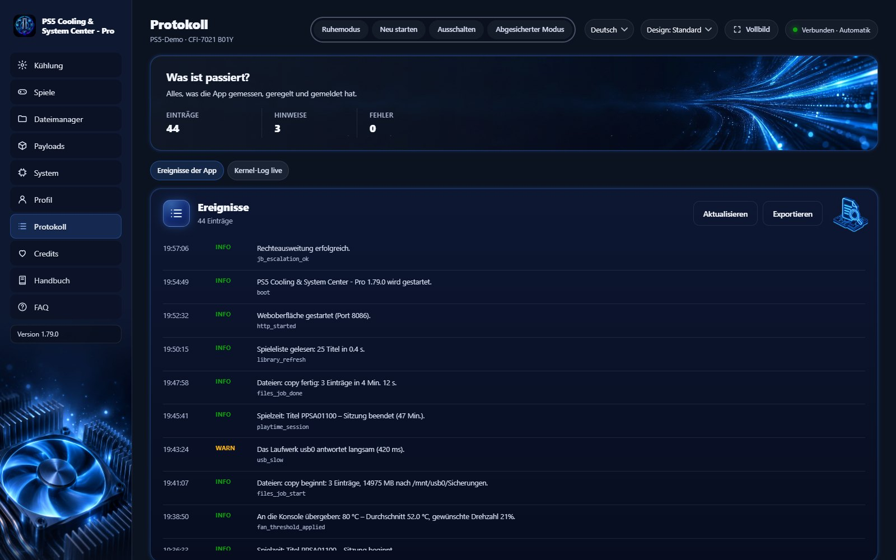</td>
    <td align="center">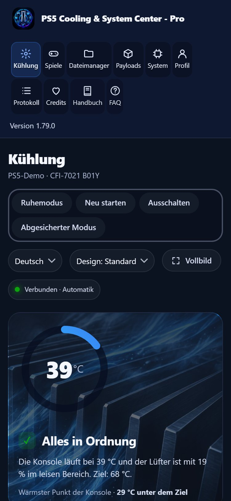</td>
  </tr>
  <tr>
    <td>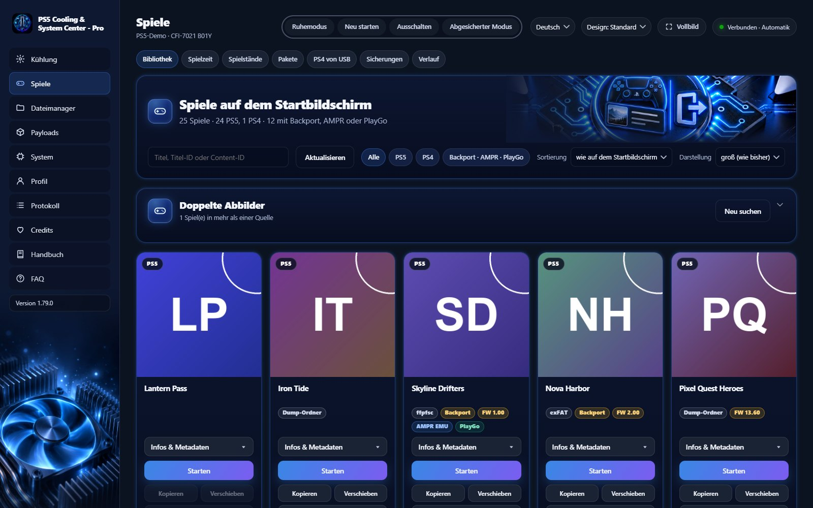</td>
    <td align="center" valign="middle"><sub>Spel i stor vy: stora omslag, knappar med text (växlas på sidan Spel)</sub></td>
  </tr>
</table>
<sub>Alla bilder använder exempeldata och påhittade spel; gränssnittet visas på tyska.</sub>
</details>

### Vyer i helskärmsappen

<table>
  <tr>
    <td width="50%">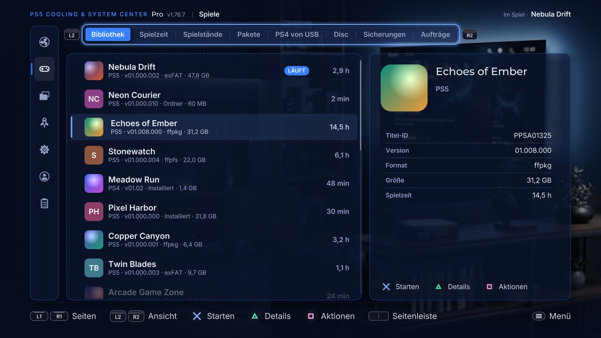</td>
    <td width="50%">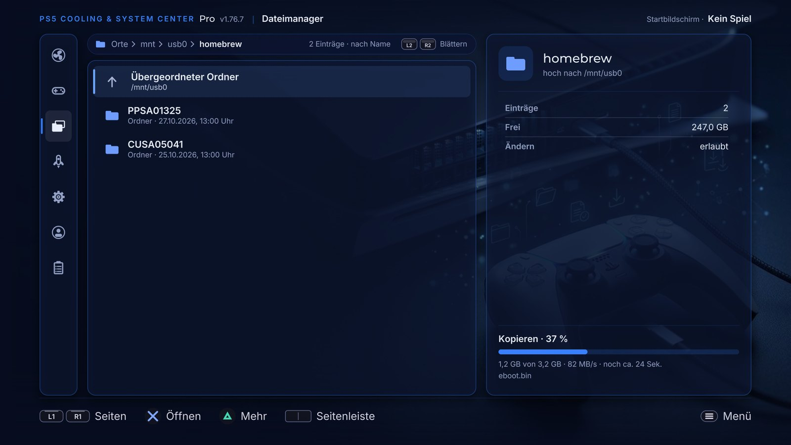</td>
  </tr>
  <tr>
    <td align="center"><sub>Spel: bibliotek med start, detaljer och åtgärder</sub></td>
    <td align="center"><sub>Filhanterare: kopiering med hastighet och återstående tid</sub></td>
  </tr>
  <tr>
    <td width="50%">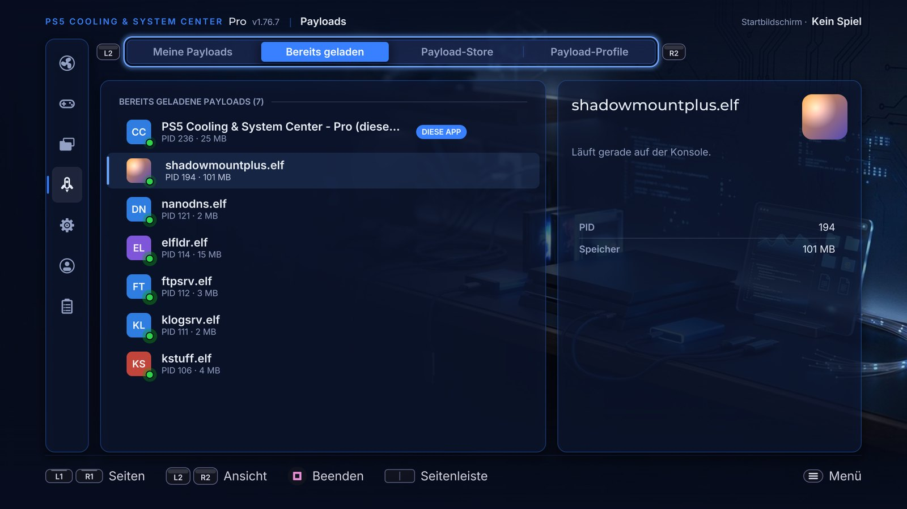</td>
    <td width="50%">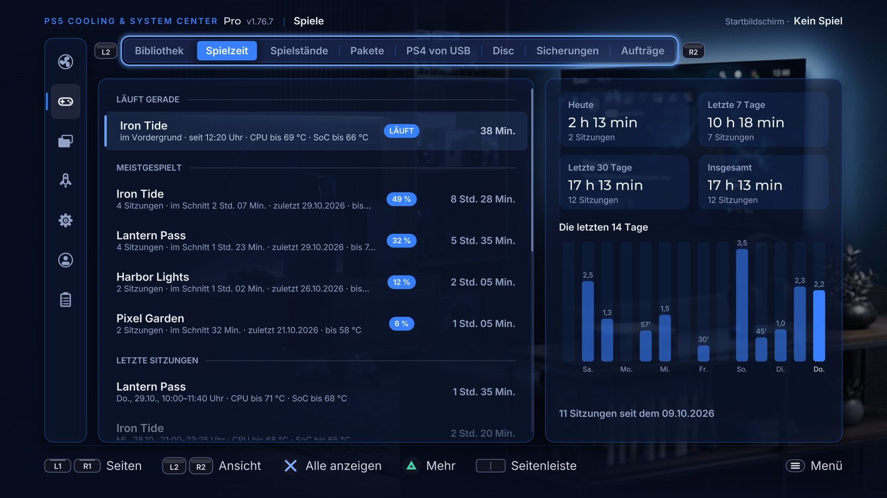</td>
  </tr>
  <tr>
    <td align="center"><sub>Payloads: se och avsluta pågående</sub></td>
    <td align="center"><sub>Speltid med dagsöversikt</sub></td>
  </tr>
</table>
<sub>Alla bilder använder exempeldata och påhittade spel; gränssnittet visas på tyska.</sub>

<details>
<summary><b>Alla funktioner i detalj</b></summary>

**Kylning**
- Håller en måltemperatur (standard 66 °C, justerbar 50–91 °C) med glidande medelvärde, dödzon och trend och ändrar fläkthastigheten bara i små steg.
- Tyst, balanserat och kyligt läge, snabbval och egna regler per spel.
- Över säkerhetstemperaturen (standard 78 °C) bestämmer bara hårdvaran; när appen inte körs reglerar konsolen sig själv.
- Nattläge: ett tystare mål mellan två klockslag; tiden är den på den enhet där sidan är öppen.
- Fläkttest med ett knapptryck (svarar fläkten på tröskeln?) och konsolens inlärda lägsta fläkthastighet (20 % i vila, 34 % i spel), som visas i diagnosen.

**Spel**
- Starta (från konsolens webbläsare stängs sidan direkt), stäng, kopiera till andra enheter, flytta eller packa upp med ShadowMountPlus.
- Konvertera till exFAT-, ffpkg- och ffpfsc-avbilder utan dator; allt läses tillbaka och kontrolleras efter skrivningen, med en `.sha256`-fil.
- LZ4-asset-paket, AMPR-index, APR-EMU (ampr_emu och AMPR EMU NG), PlayGo-stub och DLC-moduler per spel; kontrollera, packa upp och reparera avbilder.
- PS4 från USB: PS4-fake-PKG från en USB-enhet in i biblioteket utan installation (PS4Mount av gasb07).
- Skiva: visar vilken skiva som ligger i enheten (PS2/PS3/PS4/PS5, titel-ID) och gör en avbild av PS2-DVD och PS3-skivor med CRC-32, MD5 och SHA-1, på begäran kontrollerad mot Redump (efter ps-disc-detect).
- Speltid med temperaturer, säkerhetskopiera och återställ spelsparningar, hitta, dela och installera paket, historik över alla jobb.

**Hantering**
- Filhanterare: visa, redigera, hämta och ladda upp (även hela mappar), skapa mappar, byta namn, kopiera, flytta, ta bort – överallt, med hastighet och återstående tid vid kopiering; borttagning frågar först och anger vad som försvinner.
- Payloads: se och avsluta pågående, starta egna `.elf` från en mapp eller ett USB-minne, profiler som startföljd; hämta och uppdatera payloads från itsPLK:s Payload Manager-lista (med SHA-256-kontroll).
- Profil: visningsnamn och profilbild (30 inbyggda bilder eller en egen fil).
- Tema: Standard, Ljust, Mörkt och Optimal (snabbast att rita, tänkt för TV:n); varje enhet minns sitt val.
- System: modell, firmware, drifttid, lagring, nätverk; råa sensorer och diagnos i expertläge.
- Sidhuvud på varje sida: viloläge, starta om, stäng av, felsäkert läge (ett klick var).

**Teknik**
- Egen HTTP-server utan tredjepartsbibliotek, ett dokumenterat [JSON-gränssnitt](docs/API.md), inställningar i `/data/PS5-Cooling-Center/config.json`.
- Ingen internetåtkomst, utom på knapptryck: ”Hämta payloads” hämtar payload-listan och filerna från GitHub, ”Hämta AMPR EMU NG” en nyare utgåva därifrån. I övrigt pratar appen bara med program på konsolen och med webbläsarna i hemnätverket.

</details>

## Snabbstart

1. Hämta `PS5_Cooling_System_Center_v<version>.elf` från [Releases](../../releases).
2. Skicka den till konsolen (ELF-laddare, port **9021**), till exempel:
   ```bash
   nc -q0 <PS5-IP> 9021 < PS5_Cooling_System_Center_v1.82.0.elf
   ```
3. Öppna **`http://<PS5-IP>:8086`** i en webbläsare (aviseringen uppe till vänster på TV:n visar också adressen).

> [!TIP]
> **Starta utan att skicka:** packa upp `FAKE86921.zip` (helskärmsapp med handkontroll) och/eller `FAKE86922.zip` (webbgränssnitt i webbläsaren) från releasen och kopiera mapparna till `/data/homebrew/`. ShadowMountPlus lägger till rutorna; ett tryck startar appen.

> [!IMPORTANT]
> Bara **en** instans får köra åt gången, annars kämpar två program om fläkten. En gammal instans kan avslutas på sidan ”Payloads”. Mer i [LIESMICH](docs/LIESMICH.txt) (tyska).

## Krav

| | |
| --- | --- |
| **Konsol** | Jailbreakad PS5 med en ELF-laddare på port 9021 ([elfldr](https://github.com/ps5-payload-dev/elfldr) eller liknande) |
| **Firmware** | **Stöd för FW 4.03 till 14.10** |
| **Testad** | PS5 Pro (CFI-7021), firmware 12.00; flera användare rapporterar att även 4.xx till 10.xx och 13.60 fungerar |
| **Fläkt** | [kstuff](https://github.com/EchoStretch/kstuff-lite) (utan den fungerar sensorer och gränssnitt, men inte fläktstyrningen) |
| **Nätverk** | En webbläsare i samma nätverk, eller konsolens egen webbläsare |
| **Valfritt** | [ShadowMountPlus](https://github.com/drakmor/ShadowMountPlus) för att flytta, packa upp och för startrutan |

<details>
<summary>Firmware och SDK i detalj</summary>

ELF-filen är byggd med PS5-payload-SDK **v0.45**, vars startkod känner till firmware **från 4.03 upp till 14.10**. En firmware som startkoden inte känner till når aldrig `main()`: programmet startar då inte alls och skriver ingenting i loggen. För 13.00 till 13.40 finns ännu inga rapporter (startkoden känner till dem). Grafiktemperaturen finns bara på Pro.
</details>

## Användning

| Sida | Innehåll |
| --- | --- |
| **Kylning** | Status, historik, sensorer, måltemperatur, driftläge, profiler per spel |
| **Spel** | Bibliotek, speltid, spelsparningar, paket, PS4 från USB, säkerhetskopior, historik |
| **Filhanterare** | Mappar på konsolen och enheterna |
| **Payloads** | Pågående, sparade och USB-payloads, profiler, hämta payloads |
| **System** | Konsol, lagring, nätverk, diagnos |
| **Profil** | Visningsnamn och profilbild |
| **Logg** | Appens händelser och den levande kärnloggen |
| **Medverkande** | Tack till utvecklarna; dessutom **handboken** och **FAQ** på sju språk |

**På handkontrollen (konsolens webbläsare):** L1 / R1 föregående / nästa sida · L2 / R2 rulla upp / ned · Mute två gånger: temperatur och fläkt på TV:n.

> [!WARNING]
> Gränssnittet har **ingen inloggning**: varje enhet i hemnätverket kan läsa och ändra. Ställ inte in portvidarebefordran till port 8086. Vill du bara tillåta konsolens webbläsare, sätt `bind_address` till `127.0.0.1`. Detaljer i [handboken](docs/HANDBUCH.md#zugriff-und-sicherheit-im-heimnetz) och i [säkerhetspolicyn](SECURITY.md).

## Dokumentation

| Dokument | Innehåll |
| --- | --- |
| [Handbok](docs/HANDBUCH.md) | Användning i detalj (tyska; också i appen, på sju språk) |
| [API](docs/API.md) | Alla slutpunkter och konfigurationsfält |
| [Utveckling](docs/ENTWICKLUNG.md) | Bygga, skicka, felsökning, källkodens uppbyggnad |
| [Ändringar](CHANGELOG.md) | Vad som ändrats i vilken version |
| [Beslutslogg](docs/ERWEITERUNGEN.md) | Varför saker är byggda som de är, vad som mätts |
| [Tredjepartsdelar](THIRD_PARTY_NOTICES.md) | Övertagen kod och dess licenser |
| [Bidra](CONTRIBUTING.md) · [Säkerhet](SECURITY.md) | Bidrag och rapportering av sårbarheter |

<details>
<summary><b>Bygga från källkoden</b></summary>

Du behöver [PS5-payload-SDK](https://github.com/ps5-payload-dev/sdk) **v0.42 eller nyare** (testad med v0.45); bygget kontrollerar detta och avbryts med ett äldre SDK. I Windows räcker Git Bash med LLVM 21:

```bash
tools/build-windows.sh
```

I Linux eller WSL:

```bash
export PS5_PAYLOAD_SDK=$HOME/ps5sdk/sdk
make
```

Resultatet är `PS5_Cooling_Center.elf`; `tools/make_starter.sh` bygger startrutan. Allt annat står i [docs/ENTWICKLUNG.md](docs/ENTWICKLUNG.md).
</details>

## Juridisk information och ansvarsfriskrivning

> [!CAUTION]
> **Ingen officiell produkt, ingen piratkopiering, inget ansvar.** Projektet har ingen koppling till konsolens rättighetsinnehavare. Det innehåller inga spel, ingen firmware, inga tredjepartsnycklar (bara en offentligt känd nyckel för egenbyggda testpaket, se THIRD_PARTY_NOTICES.md) och ingen kod för att kringgå kopieringsskydd, och det laddar inget från internet utom, på knapptryck, payload-listan med dess filer och en nyare utgåva av AMPR EMU NG från GitHub. Att modifiera en konsol kan kosta garanti och konto; risken bär den som gör det. Programmet tillhandahålls **utan någon garanti**.

<details>
<summary>Fullständig text</summary>

> Detta avsnitt är allmän information och ingen juridisk rådgivning. Den som använder projektet ansvarar själv för att användningen är tillåten i det egna landet och gentemot de egna avtalsparterna.

- **Ingen officiell produkt.** ”PlayStation”, ”PS5” och tillhörande logotyper är varumärken som tillhör sina respektive ägare. Projektet har ingen koppling till dem och stöds eller godkänns inte av dem. Alla övriga namn tillhör sina respektive ägare.
- **Din konsol, ditt ansvar.** Programmet körs bara på en konsol som ägaren själv har modifierat. Att modifiera den kan strida mot användarvillkor och leda till förlorad garanti, avstängning av kontot eller konsolen och i vissa länder också rättsliga följder. Risken bär den som modifierar konsolen och använder programmet.
- **Ingen piratkopiering.** Projektet är **inte** avsett att skaffa, sprida eller använda piratkopior och stöder det inte. Kopiering, flyttning och konvertering fungerar bara på spel som redan ligger på din egen konsol och är avsedda för säkerhetskopior av lagligt förvärvade spel. Att hitta, dela, installera och montera paket från USB fungerar bara på paket som du själv har lagt på konsolen eller en enhet; appen skaffar inga. Att sprida upphovsrättsskyddat innehåll är straffbart i de flesta länder. Hjälp med det finns inte här, inte heller i ärenden (issues).
- **Inga tredjeparts systemfiler i förrådet.** Systembibliotek, firmware och proprietära SDK-filer varken levereras eller tas emot (se [CONTRIBUTING](CONTRIBUTING.md)). De 30 profilbilderna har skapats av författaren.
- **Ingen garanti, inget ansvar.** Programmet ingriper i konsolens fläktstyrning och systemfunktioner. Det tillhandahålls i befintligt skick, **utan någon garanti** (GNU GPL, avsnitt 15 och 16). Författaren ansvarar inte för skador på konsol, data eller konton. En dammig konsol kyler sämre, hur fläkten än styrs.
- **Integritet.** Historik, logg och inställningar stannar på konsolen i `/data/PS5-Cooling-Center/`. Appen skickar inga data till internet. Enda undantaget finns i webbläsaren: sidan ”Medverkande” laddar den lilla ikonen från github.com en gång för att se om webbläsaren har internet; först då går länkarna att klicka på.
- **Tredjepartsprojekt** står under sina egna licenser, se [THIRD_PARTY_NOTICES.md](THIRD_PARTY_NOTICES.md).
</details>

## Bidra och rapportera fel

Fel och önskemål är välkomna som [ärende (issue)](../../issues), med konsolmodell, firmware, version och den exporterade loggen (sidan ”Logg”). Bidrag: [CONTRIBUTING.md](CONTRIBUTING.md). Rapportera säkerhetsproblem enligt beskrivningen i [SECURITY.md](SECURITY.md).

## Medverkande och tack

Det här projektet står på axlarna av PS5-homebrew-gemenskapen. **Tack!** Ett alldeles särskilt tack till **[Gezine](https://github.com/Gezine)**: utan Gezines arbete skulle inget homebrew köra på många konsoler, och därmed inte heller den här appen.

<details>
<summary><b>Plattform och verktyg</b></summary>

- **John Törnblom och alla som bidrar till [ps5-payload-dev](https://github.com/ps5-payload-dev)**: [PS5-payload-SDK](https://github.com/ps5-payload-dev/sdk), payload-laddaren [elfldr](https://github.com/ps5-payload-dev/elfldr), [klogsrv](https://github.com/ps5-payload-dev/klogsrv), [ftpsrv](https://github.com/ps5-payload-dev/ftpsrv) och [websrv](https://github.com/ps5-payload-dev/websrv).
- **Utvecklarna av kstuff**: [sleirsgoevy](https://github.com/sleirsgoevy), [EchoStretch](https://github.com/EchoStretch) och [drakmor](https://github.com/drakmor) ([kstuff-lite](https://github.com/EchoStretch/kstuff-lite)). Utan kstuff fanns ingen åtkomst till fläktstyrenheten.
</details>

<details>
<summary><b>Kod från andra projekt (porterad eller inbyggd)</b></summary>

- **[gasb07](https://github.com/gasb07), [PS4Mount](https://github.com/gasb07/ps4mount)** (GPL-3.0): PS4-fake-PKG från en USB-enhet utan installation; källkoden är inbyggd som fliken ”PS4 från USB”.
- **[RenanGBarreto](https://github.com/RenanGBarreto), [rdmrocha](https://github.com/rdmrocha) och de som bidrar till [MkPFS](https://github.com/PSBrew/MkPFS)** ([PSBrew](https://github.com/PSBrew), GPL-3.0): exFAT-, PFS- och PFSC-avbilder.
- **[SvenGDK](https://github.com/SvenGDK), [UFS2Tool](https://github.com/SvenGDK/UFS2Tool)** (BSD-2-Clause): förebilden för UFS2-/ffpkg-skrivaren.
- **[drakmor](https://github.com/drakmor)**: [ampr_emu](https://github.com/drakmor/ampr_emu) (LZ4-asset-paket, APR-EMU), [pgo_stub](https://github.com/drakmor/pgo_stub) och [dlc_emu](https://github.com/drakmor/dlc_emu) (inbyggda versioner, GPL-3.0).
- **[quer3q](https://github.com/quer3q), [ampr-emu-ng](https://github.com/quer3q/ampr-emu-ng)** (GPL-3.0): AMPR EMU NG, en vidareutveckling av ampr_emu som också läser zstd-paket (utgåva 0.3.5 inbyggd, nyare hämtar appen på begäran).
- **[BlackBearReloaded](https://github.com/BlackBearReloaded), ps5-native-app-boilerplate** (GPL-3.0): hur startrutan byggs som en inbyggd titel.
- **[itsPLK](https://github.com/itsPLK), [ps5-pkg-manager](https://github.com/itsPLK/ps5-pkg-manager)** (GPL-3.0): paketens uppbyggnad och installationsförloppet (egen kod efter denna förebild).
- **[phantomptr](https://github.com/phantomptr), [ps5upload](https://github.com/phantomptr/ps5upload)** (GPL-3.0): profilfunktionen och profilbildens format.
- **[slopmaster33](https://github.com/slopmaster33), [webhb](https://github.com/slopmaster33/webhb)** (GPL-3.0): QR-kodare.
- **[danthespal](https://github.com/danthespal), [MkPFS.CSharp](https://github.com/danthespal/MkPFS.CSharp)** (GPL-3.0): de fyra testade LZ4-profilerna (ASTRO BOT, EA Sports UFC 6, Insomniac-motorn, Unity-motorn), inbyggda oförändrade.
- **[Knutwurst](https://github.com/knutwurst), [PatchDL](https://github.com/knutwurst/ps5-patchdl)** (GPL-3.0): appens egen namnuppslagning och HTTPS-hämtning (för payload-butiken).
- **[BearSSL](https://bearssl.org/)** 0.6 (Thomas Pornin, MIT): TLS för payload-butiken.
- **[Eric Biggers](https://github.com/ebiggers), [libdeflate](https://github.com/ebiggers/libdeflate)** (MIT) · **[Dave Gamble](https://github.com/DaveGamble), [cJSON](https://github.com/DaveGamble/cJSON)** (MIT) · **[LZ4](https://github.com/lz4/lz4)** (BSD-2-Clause).
</details>

<details>
<summary><b>Samspel, kunskap och förebilder</b></summary>

- **[drakmor](https://github.com/drakmor)**: [ShadowMountPlus](https://github.com/drakmor/ShadowMountPlus) (montera, flytta, packa upp spel) och [ps5-hwinfo](https://github.com/drakmor/ps5-hwinfo) (strömskenor, klockfrekvenser).
- **V-10, [exFAT2AMPR](https://github.com/exFAT2AMPR/exfat2ampr)**: listan för ”Automatiskt”, inspelning för att skapa profiler, skötsel av spelens insticksmoduler.
- **theghostonline (Husam Osman), [PS5 LZ4 Compression](https://github.com/theghostonline/PS5-LZ4-Compression)**: filer som måste ligga löst vid packning, rättigheter 0777, reparation vid kontroll av paketen, urval av de testade profilerna.
- **[kerrdec97](https://github.com/kerrdec97), [exFAT Image Builder](https://github.com/kerrdec97/ps5-exfat-builder)**: parametrar för `.ffpkg`-avbilder.
- **[itsPLK](https://github.com/itsPLK)**: [ps5-unified-autoloader](https://github.com/itsPLK/ps5-unified-autoloader) och [ps5-payload-manager](https://github.com/itsPLK/ps5-payload-manager) (förebild och lista för ”Hämta payloads”, [ps5-payloads-mirror](https://github.com/itsPLK/ps5-payloads-mirror)).
- **[StonedModder](https://github.com/StonedModder), [ps-game-state-lib](https://github.com/StonedModder/ps-game-state-lib)** (MIT): igenkänning av pågående spel.
- **[etaHEN](https://github.com/etaHEN/etaHEN)** och **[onionHEN](https://github.com/aydencharles/onionHEN)**: systemanrop, mätvärden, bildfrekvens.
- **[Soniciso](https://git.etawen.dev/soniciso), [Elf Arsenal](https://git.etawen.dev/soniciso/elf-arsenal)**: förebild för många funktioner (koden skrevs varje gång om).
- **BestPig, [BackPork](https://github.com/BestPig/BackPork)**: principen med ersättningsbibliotek.
- **Juma Sayeh och Osama Abualia, PS5 Game Compressor**: idéer för kontroll och konvertering (allt omskrivet; källkoden har ingen licens).
- **Linux-drivrutinen `hid-playstation`** (DualSense-batteri) · **Xbox 360 DashLaunch** (tanken på tyst reglering).
</details>

<details>
<summary><b>Tack till gemenskapen</b></summary>

Deras kod finns inte i den här appen, men utan deras delade arbete skulle scenen inte finnas som den gör: [owendswang](https://github.com/owendswang), [LightningMods](https://github.com/LightningMods), [Andy Nguyen / TheFloW](https://github.com/TheOfficialFloW), [Specter](https://github.com/Cryptogenic), [ChendoChap](https://github.com/ChendoChap), [idlesauce](https://github.com/idlesauce), [flatz](https://github.com/flatz), [Al Azif](https://github.com/Al-Azif), [zecoxao](https://github.com/zecoxao), [ArkSama](https://github.com/ArkSama), [nexgen999](https://github.com/nexgen999), [matem6](https://github.com/matem6), [Phoenixx1202](https://github.com/Phoenixx1202), [SiSTR0](https://github.com/SiSTR0) – och alla andra som bidrar med kod, tester, guider eller svar. I appen står alla med bild på sidan ”Medverkande”.
</details>

Saknas du här eller är felaktigt beskriven: säg till, så kompletteras listan gärna.

## Licens

Copyright © 2026 strongt1me · **GNU General Public License v3.0 eller senare**, se [LICENSE](LICENSE). Till och med 1.45.1 gällde MIT; från 1.46.0 gäller GPL-3.0-or-later eftersom delar är hämtade från GPL-projekt (detaljer i [THIRD_PARTY_NOTICES.md](THIRD_PARTY_NOTICES.md)).

<sub>Den här README finns också på [Deutsch](README.md), [English](README.en.md), [Italiano](README.it.md), [Español](README.es.md), [Français](README.fr.md) och [Русский](README.ru.md). Handboken och FAQ följer med varje release på alla sju språk.</sub>
